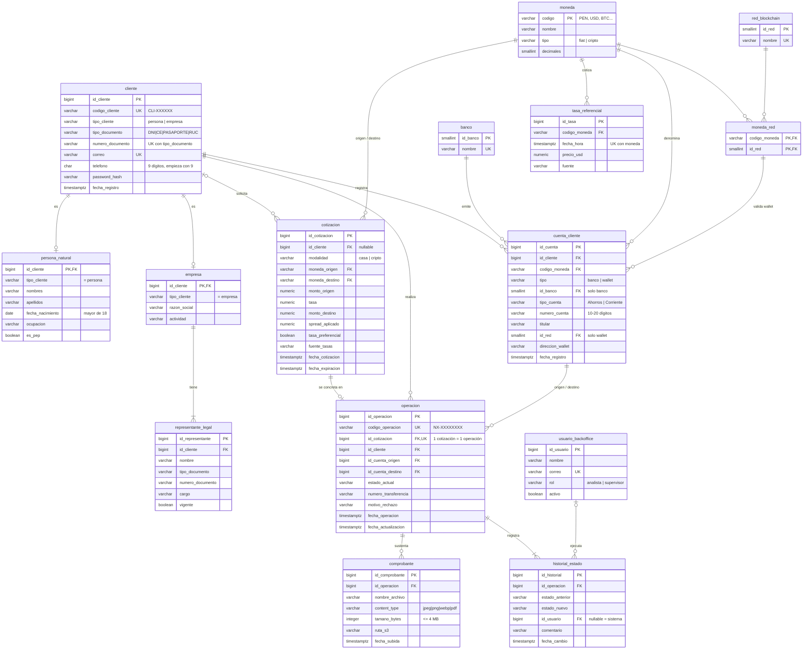

# NexoCambio — Análisis de negocio y modelo Entidad–Relación (borrador para validar)

## 1.1 Análisis del negocio

| Aspecto | Descripción |
|---|---|
| **Giro y modelo de negocio** | Casa de cambio digital de divisas (PEN, USD, EUR) y criptoactivos (USDT, USDC, BTC, ETH). Gana por el *spread*: la diferencia entre la tasa de mercado y la tasa ofrecida al cliente (0,45 % en casa de cambio, 1,2 % en cripto; el spread baja 40 % en montos ≥ 5 000 USD, la "tasa preferencial"). |
| **Clientes** | Personas naturales (DNI, CE o pasaporte; mayores de edad; pueden ser PEP) y empresas (RUC, con representante legal). |
| **Productos / servicios** | 1) Cambio de divisas (modalidad *casa*). 2) Compra/venta de criptoactivos (modalidad *cripto*). 3) Cotización con tasa garantizada por 5 minutos. |
| **Canales** | Aplicación web (Angular) sobre una API REST. Transferencias bancarias (BCP, Interbank, BBVA, Scotiabank, BanBif, Pichincha) y redes blockchain (TRC20, ERC20, Solana, Bitcoin). Back-office web para los analistas. |
| **Proceso seleccionado** | **Operación de cambio de punta a punta**: cotizar → registrar la operación (cuentas de origen y destino) → subir el comprobante de transferencia → validación en back-office → Procesada o Rechazada. |
| **Actores** | Visitante (cotiza sin cuenta), cliente (persona o empresa), representante legal, analista de back-office, bancos y redes blockchain (externos), proveedores de tasas de referencia (externos). |
| **Eventos / transacciones** | Registro de cliente, publicación de una tasa de referencia, emisión de una cotización, creación de una operación, carga de un comprobante, cambio de estado (en proceso, procesada, rechazada). |
| **Información generada** | Perfil KYC del cliente, cuentas bancarias y billeteras, serie histórica de tasas, cotizaciones (incluidas las no concretadas), operaciones con montos y tasas, comprobantes, historial de estados con fecha y responsable, motivos de rechazo. |

**Preguntas que el negocio podría responder con datos**

1. ¿Qué volumen (en USD) se transa por mes y por par de monedas? ¿Cómo crece mes a mes?
2. ¿Qué porcentaje de cotizaciones termina en una operación (conversión)?
3. ¿Cuánto ingreso por spread se genera por modalidad y tipo de cliente?
4. ¿Cuánto tarda en promedio el back-office en validar una operación? ¿Qué analista es más rápido?
5. ¿Cuál es la tasa de rechazo y sus motivos más frecuentes? ¿Varía por banco?
6. ¿Quiénes son los clientes de mayor valor y cuáles dejaron de operar (abandono)?
7. ¿En qué horas y días se concentra la demanda?
8. ¿Qué operaciones se salen del comportamiento habitual del cliente (monto, frecuencia, cliente PEP)? Esta pregunta conecta con la Parte 2.

## 1.2 Modelo Entidad–Relación

### Entidades (15)

| # | Entidad | Tipo | Propósito |
|---|---|---|---|
| 1 | `cliente` | Núcleo (supertipo) | Datos comunes: correo, celular, documento, contraseña |
| 2 | `persona_natural` | Subtipo de cliente | Nombres, apellidos, nacimiento, ocupación, PEP |
| 3 | `empresa` | Subtipo de cliente | Razón social, actividad económica |
| 4 | `representante_legal` | Dependiente de empresa | Quien opera en nombre de la empresa |
| 5 | `moneda` | Catálogo | Divisas y criptoactivos, con su tipo y decimales |
| 6 | `banco` | Catálogo | Bancos aceptados |
| 7 | `red_blockchain` | Catálogo | TRC20, ERC20, Solana, Bitcoin |
| 8 | `moneda_red` | **Asociativa N:M** | Qué redes acepta cada criptoactivo |
| 9 | `cuenta_cliente` | Núcleo | Cuentas bancarias y billeteras del cliente |
| 10 | `tasa_referencial` | Serie temporal | Precio en USD de cada moneda en el tiempo |
| 11 | `cotizacion` | Transacción | Tasa garantizada por 5 minutos (puede ser anónima) |
| 12 | `operacion` | Transacción | La operación de cambio |
| 13 | `comprobante` | Dependiente | Archivo de la transferencia (metadatos; el archivo está en S3) |
| 14 | `historial_estado` | Auditoría | Cada cambio de estado, con fecha y responsable |
| 15 | `usuario_backoffice` | Núcleo | Analistas que validan las operaciones |

### Diagrama

### Cardinalidades

| Relación | Cardinalidad | Regla de negocio |
|---|---|---|
| cliente – persona_natural / empresa | 1 : 0..1 (excluyente) | Un cliente es **o** persona **o** empresa |
| empresa – representante_legal | 1 : 1..N | Toda empresa tiene al menos un representante; se guarda el histórico |
| cliente – cuenta_cliente | 1 : 0..N | Las cuentas se reutilizan entre operaciones |
| moneda – red_blockchain | **N : M** (vía `moneda_red`) | USDT admite TRC20 y ERC20; ERC20 admite USDT, USDC y ETH |
| cliente – cotizacion | 0..1 : 0..N | `/cotizar` es pública: un visitante puede cotizar sin cuenta |
| cotizacion – operacion | 1 : 0..1 | Una cotización se usa una sola vez (`UNIQUE`) |
| cuenta_cliente – operacion | 1 : 0..N (dos roles) | Cuenta de origen y cuenta de destino |
| operacion – comprobante | 1 : 0..N | El cliente puede reemplazarlo mientras está "Pendiente de validación" |
| operacion – historial_estado | 1 : 1..N | Cada transición queda registrada |
| usuario_backoffice – historial_estado | 0..1 : 0..N | NULL cuando el cambio lo hace el sistema o el cliente |

### Restricciones relevantes (se implementan en PostgreSQL)

**Identidad y unicidad**
- `UNIQUE (tipo_documento, numero_documento)` y `UNIQUE (correo)` en `cliente`: reemplazan los ítems de unicidad que hoy usa DynamoDB.
- `UNIQUE (id_cotizacion)` en `operacion`: una cotización no puede generar dos operaciones.

**Subtipos y pertenencia**
- **Subtipo excluyente**: `persona_natural` y `empresa` repiten `tipo_cliente`, fijado por `CHECK`, y referencian a `cliente(id_cliente, tipo_cliente)` con una FK compuesta. Así es imposible que un cliente sea persona y empresa a la vez.
- **Las cuentas pertenecen al cliente de la operación**: FK compuesta `(id_cuenta_origen, id_cliente)` → `cuenta_cliente(id_cuenta, id_cliente)`, y lo mismo para el destino.

**Cuentas bancarias y billeteras**
- **Red válida para el criptoactivo**: FK compuesta `(codigo_moneda, id_red)` → `moneda_red`.
- **Coherencia banco/wallet**: `CHECK`. Si `tipo = 'banco'`, se exigen banco, tipo de cuenta y número, y la red y la dirección son NULL. Si `tipo = 'wallet'`, al revés.

**Formatos y rangos (`CHECK`)**
- Celular `^9\d{8}$`, cuenta `^\d{10,20}$`, wallet `^[A-Za-z0-9]{26,64}$`.
- Mayoría de edad.
- `monto_origen > 0` y `moneda_origen <> moneda_destino`.
- `fecha_expiracion > fecha_cotizacion`.
- `tamano_bytes BETWEEN 1 AND 4194304`.
- `content_type IN (...)`.

**Estados y transiciones**
- `CHECK ((estado_anterior, estado_nuevo) IN (...))` en `historial_estado` replica la máquina de estados del backend:

  `NULL → Pendiente de comprobante → Pendiente de validación → {En proceso, Rechazada}` y `En proceso → {Procesada, Rechazada}`.
- `motivo_rechazo` es obligatorio si y solo si el estado es "Rechazada".

### Principales decisiones de diseño

1. **Supertipo/subtipo para el cliente.** En DynamoDB la persona y la empresa conviven en un solo ítem con atributos opcionales. En relacional, una tabla única dejaría muchos NULL y no permitiría exigir `NOT NULL` en los campos propios de cada tipo.
2. **Se normalizan los datos que en DynamoDB están anidados.**
   - El `representante` de la empresa pasa a su propia tabla.
   - El `historial` (una lista dentro de la operación) pasa a `historial_estado`.
   - Los campos `origen` y `destino` pasan a `cuenta_cliente`, una tabla reutilizable entre operaciones.
3. **La operación no repite los datos de la cotización** (modalidad, monedas, montos, tasa). Se obtienen con JOIN por `id_cotizacion` (3FN).
4. **Desnormalizaciones justificadas:**
   - `cotizacion.tasa` y `monto_destino` se calculan a partir de `tasa_referencial`, pero se **guardan**. Son un compromiso contractual con el cliente: si después cambia la tasa de referencia, la operación histórica no puede cambiar.
   - `operacion.estado_actual` se deduce del último registro de `historial_estado`, pero se guarda para que la cola del back-office (`WHERE estado_actual = ...`) no tenga que buscar el último estado de cada operación. Se mantiene consistente porque ambos se escriben en la misma transacción.
5. **Catálogos fijos con `CHECK` en vez de tablas** (tipo de documento, estados, modalidad, ocupación). Son pocos valores que solo cambian con el código, y así el modelo se mantiene dentro de 15 entidades. En cambio, `moneda`, `banco` y `red` sí son tablas: tienen atributos propios y participan en relaciones.
6. **Claves sustitutas `BIGINT IDENTITY`** para joins e índices eficientes. El código visible al cliente (`CLI-…`, `NX-…`) se guarda aparte con `UNIQUE`.
7. **Tipos de datos:**
   - `NUMERIC(24,8)` para montos y precios (BTC necesita 6 decimales y no se admite el error de redondeo de `float`).
   - `NUMERIC(20,10)` para las tasas.
   - `TIMESTAMPTZ` para todas las fechas (el negocio opera en hora de Lima).
8. **La cotización puede ser anónima.** Así se mide la conversión de visitantes a clientes, una de las preguntas de negocio.
