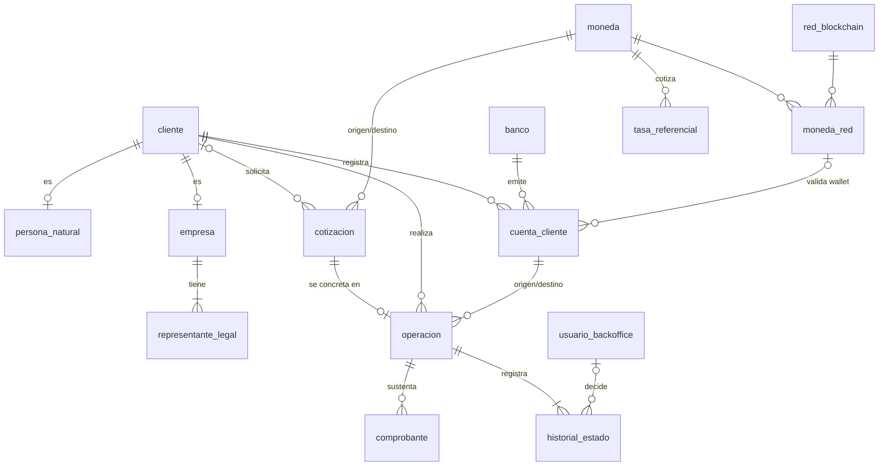

<div class="portada">
<div class="institucion">Universidad de Ingeniería y Tecnología</div>
<div class="escuela">Escuela de Posgrado</div>

<div class="titulo">NexoCambio</div>
<div class="subtitulo">Parte 1 · Análisis de negocio, modelo relacional y explotación de datos en PostgreSQL</div>
<div class="datos">
<p><strong>AUTORES</strong></p>
<p>Frank Laura</p>
<p>Josue Campos</p>
<p>Mauricio Vallejos</p>
<p><strong>DOCENTE</strong></p>
<p>Luis Chicoma</p>
<p><strong>CURSO</strong></p>
<p>Base de Datos · Grupo 1</p>
<p>Lima – Perú</p>
<p>2026</p>
</div>
</div>

# Contenido

1. Análisis del negocio
2. Modelo Entidad–Relación
3. Implementación en PostgreSQL
4. Consultas SQL orientadas al negocio
5. Feature Engineering con SQL
6. Optimización de consultas e índices
7. Conclusiones
8. Anexo: reproducción del proyecto

**Archivos del entregable** (carpeta `grupo_01/`):

| Archivo | Contenido |
|---|---|
| `informe.pdf` / `informe.docx` | Este documento (en PDF y en Word) |
| `modelo_ER.pdf` | Diagrama ER completo, cardinalidades y diccionario de datos |
| `sql/01_schema.sql` | Creación del esquema `nexocambio` |
| `sql/02_tables.sql` | 15 tablas con PK, FK, UNIQUE, CHECK y NOT NULL |
| `sql/03_data.sql` | Carga: catálogos con INSERT INTO y datos sintéticos con `\copy` |
| `sql/04_queries.sql` | 10 consultas de negocio y 8 features |
| `sql/05_indexes.sql` | EXPLAIN y EXPLAIN ANALYZE antes y después de cada optimización |
| `datos/dataset.csv` | Muestra plana de 10 205 operaciones (~1 % del total) |
| `generador/generar_datos.py` | Generador de los datos sintéticos completos (lo usa `03_data.sql`) |
| `pruebas/pruebas_restricciones.sql` | 29 casos inválidos que las restricciones deben rechazar |
| `resultados/` | Salidas completas de `04_queries.sql` y `05_indexes.sql` |

# 1. Análisis del negocio

NexoCambio es una **casa de cambio digital** que opera divisas (PEN, USD, EUR) y criptoactivos (USDT, USDC, BTC, ETH) a través de una aplicación web. El caso proviene del proyecto del curso de Cloud Computing, donde el sistema está implementado como un backend serverless en AWS. En este curso se diseña su **modelo relacional** a partir de las mismas reglas de negocio.

| Aspecto | Descripción |
|---|---|
| **Giro y modelo de negocio** | Compra y venta de divisas y criptoactivos. El ingreso proviene del *spread*: la diferencia entre la tasa de mercado y la tasa que se ofrece al cliente (0,45 % en casa de cambio, 1,2 % en cripto). Desde US$ 5 000 el spread baja 40 % (*tasa preferencial*). |
| **Clientes** | Personas naturales (DNI, carné de extranjería o pasaporte; mayores de edad; algunas son Personas Expuestas Políticamente, PEP) y empresas (RUC, con representante legal). |
| **Productos y servicios** | 1) Cambio de divisas (modalidad *casa*). 2) Compra y venta de criptoactivos (modalidad *cripto*). 3) Cotización con tasa garantizada por 5 minutos. |
| **Canales** | Aplicación web sobre una API REST. Transferencias bancarias (BCP, Interbank, BBVA, Scotiabank, BanBif y Banco Pichincha) y redes blockchain (TRC20, ERC20, Solana y Bitcoin). Back-office web para los analistas. |
| **Proceso seleccionado** | **La operación de cambio de punta a punta**: cotizar → registrar la operación con sus cuentas de origen y destino → subir el comprobante de transferencia → validación en back-office → Procesada o Rechazada. |
| **Actores** | Visitante (cotiza sin cuenta), cliente (persona o empresa), representante legal, analista y supervisor de back-office, bancos y redes blockchain (externos), proveedores de tasas (externos). |
| **Eventos y transacciones** | Registro de cliente, publicación de una tasa de referencia, emisión de una cotización, creación de una operación, carga de un comprobante y cada cambio de estado. |
| **Información generada** | Perfil KYC del cliente, cuentas y billeteras, serie histórica de tasas, cotizaciones (incluso las que no se concretan), operaciones con montos y tasas, comprobantes, historial de estados con fecha y responsable, y motivos de rechazo. |

**Preguntas que el negocio puede responder con datos** (se responden en la sección 4):

1. ¿Qué pares de monedas concentran el volumen y cuál es el ticket promedio? (C1)
2. ¿La tasa de rechazo depende del banco de origen? ¿Cuál es el motivo más frecuente? (C2)
3. ¿Cuántos clientes se registran y nunca operan? (C3)
4. ¿Cuánto tarda el back-office en validar y qué analista es más rápido? (C4)
5. ¿Cómo crece el volumen mes a mes? (C5)
6. ¿Quiénes son los clientes de mayor volumen y qué peso tienen? (C6)
7. ¿Dónde se pierde el cliente en el embudo de conversión? (C7)
8. ¿Cuánto ingreso por spread genera cada segmento? (C8)
9. ¿Qué clientes frecuentes están dejando de operar? (C9)
10. ¿Qué operaciones se alejan del comportamiento habitual del cliente? (C10). Esta pregunta conecta con la Parte 2: la detección de operaciones inusuales.

# 2. Modelo Entidad–Relación

El modelo tiene **15 entidades en Tercera Forma Normal**. El diagrama completo, con todos los atributos, y el diccionario de datos están en `modelo_ER.pdf`. Aquí se resume la estructura:



| # | Entidad | Tipo | Propósito |
|---|---|---|---|
| 1 | `cliente` | Núcleo (supertipo) | Datos comunes: correo, celular, documento y contraseña |
| 2 | `persona_natural` | Subtipo | Nombres, apellidos, fecha de nacimiento, ocupación y condición PEP |
| 3 | `empresa` | Subtipo | Razón social y actividad económica |
| 4 | `representante_legal` | Dependiente | Personas que operan en nombre de la empresa (con histórico) |
| 5 | `moneda` | Catálogo | Divisas y criptoactivos, con su tipo y sus decimales |
| 6 | `banco` | Catálogo | Bancos aceptados |
| 7 | `red_blockchain` | Catálogo | Redes por las que viajan los criptoactivos |
| 8 | `moneda_red` | **Asociativa N:M** | Redes que admite cada criptoactivo |
| 9 | `cuenta_cliente` | Núcleo | Cuentas bancarias y billeteras del cliente, reutilizables |
| 10 | `tasa_referencial` | Serie temporal | Precio en USD de cada moneda cada 5 minutos |
| 11 | `cotizacion` | Transacción | Tasa garantizada por 5 minutos (puede ser anónima) |
| 12 | `operacion` | Transacción | La operación de cambio |
| 13 | `comprobante` | Dependiente | Metadatos del comprobante (el archivo está en Amazon S3) |
| 14 | `historial_estado` | Auditoría | Cada transición de estado, con fecha y responsable |
| 15 | `usuario_backoffice` | Núcleo | Analistas y supervisores que validan las operaciones |

## 2.1 Cardinalidades y restricciones relevantes

- **Subtipos excluyentes.** `persona_natural` y `empresa` repiten `tipo_cliente`, fijado con un CHECK, y referencian `cliente(id_cliente, tipo_cliente)` con una FK compuesta. Así es imposible que un cliente sea persona y empresa a la vez, sin necesidad de triggers.
- **Relación N:M resuelta.** Un criptoactivo viaja por varias redes (USDT por TRC20 y ERC20) y una red lleva varios criptoactivos (ERC20 lleva USDT, USDC y ETH). La tabla asociativa `moneda_red` tiene PK compuesta. `cuenta_cliente` la referencia con la FK `(codigo_moneda, id_red)`, lo que impide registrar una wallet USDT en la red Bitcoin.
- **Pertenencia de las cuentas.** La operación referencia `(id_cuenta_origen, id_cliente)` y `(id_cuenta_destino, id_cliente)` contra `cuenta_cliente(id_cuenta, id_cliente)`. Las dos cuentas tienen que ser del cliente que opera.
- **Una cotización, una operación.** Se garantiza con UNIQUE en `operacion.id_cotizacion`.
- **Máquina de estados declarativa.** `CHECK ((COALESCE(estado_anterior,'(inicio)'), estado_nuevo) IN (...))` permite solo las transiciones del negocio. Se usa COALESCE porque un NULL dentro de IN haría pasar cualquier valor. UNIQUE `(id_operacion, estado_nuevo)` impide alcanzar dos veces el mismo estado, y otro CHECK exige el usuario de back-office en las decisiones.
- **Reglas de dominio con CHECK.** Formato de DNI, CE, pasaporte y RUC; empresa ⇔ RUC; mayoría de edad; celular `^9\d{8}$`; correo en minúsculas; coherencia banco/wallet; `monto_destino = monto_origen × tasa` con tolerancia de redondeo; vigencia de la cotización; comprobante JPG/PNG/WEBP/PDF de hasta 4 MB; motivo de rechazo obligatorio solo si el estado es Rechazada.

## 2.2 Normalización (3FN)

- **1FN.** Todos los atributos son atómicos. Los datos que en el sistema original (DynamoDB) estaban anidados pasan a sus propias tablas: el `representante` dentro del cliente, el `historial` como lista dentro de la operación, y los campos `origen` y `destino` como objetos.
- **2FN.** Las tablas con clave sustituta simple no pueden tener dependencias parciales. La única PK compuesta (`moneda_red`) no tiene atributos fuera de la clave.
- **3FN.** No hay dependencias transitivas:
  - El nombre del banco, de la red o de la moneda está en su catálogo, no en cada cuenta u operación.
  - La operación **no repite** modalidad, monedas, montos ni tasa: los obtiene de su cotización con un JOIN.
  - Los datos propios de persona y de empresa están en sus subtipos.

## 2.3 Decisiones de diseño y desnormalizaciones justificadas

1. **Tasa y monto destino guardados en la cotización.** Se podrían derivar de `tasa_referencial`, pero son un compromiso contractual con el cliente. Si después se corrige una tasa de referencia, la operación histórica no puede cambiar.
2. **`operacion.estado_actual`.** Se deduce del último registro de `historial_estado`, pero se guarda para que la cola del back-office (`WHERE estado_actual = …`) no tenga que buscar el último estado de cada operación. Se escribe en la misma transacción que el historial, y `03_data.sql` verifica que ambos coincidan.
3. **Catálogos chicos como CHECK y no como tablas** (tipo de documento, estados, modalidad, ocupación, actividad). Son pocos valores que solo cambian junto con el código de la aplicación. `moneda`, `banco` y `red_blockchain` sí son tablas porque tienen atributos propios y participan en relaciones.
4. **Claves sustitutas `BIGINT GENERATED ALWAYS AS IDENTITY`.** Dan joins e índices compactos. El código que ve el cliente (`CLI-…`, `NX-…`) se guarda aparte con UNIQUE.
5. **Cotización anónima** (`id_cliente` NULL). La ruta `/cotizar` es pública. Guardar estas cotizaciones permite medir la conversión de visitantes (C7).

# 3. Implementación en PostgreSQL

## 3.1 Esquema y tablas

`01_schema.sql` crea el esquema `nexocambio` y fija la zona horaria `America/Lima`. `02_tables.sql` crea las 15 tablas en orden de dependencias: catálogos → clientes → cuentas → tasas y cotizaciones → operaciones. Usa todos los elementos que pide el curso: `CREATE SCHEMA`, `CREATE TABLE`, `PRIMARY KEY` (simples y compuestas), `FOREIGN KEY` (simples y compuestas, con `ON DELETE CASCADE` o `SET NULL` según el caso), `UNIQUE`, `CHECK` (de columna y de tabla) y `NOT NULL`.

| Decisión de tipo | Por qué |
|---|---|
| `NUMERIC(24,8)` para montos y precios | Exactitud decimal: un `float` acumula errores de redondeo inaceptables en dinero. BTC necesita 6 decimales. |
| `NUMERIC(20,10)` para la tasa | Un par como PEN/BTC tiene tasas del orden de 0,0000028. |
| `TIMESTAMPTZ` para todas las fechas | Instantes absolutos; se muestran en hora de Lima. |
| `CHAR(9)` para el celular | Longitud fija en Perú. |
| `SMALLINT` en catálogos, `BIGINT` en transacciones | Tamaño acorde al volumen esperado de cada tabla. |
| `VARCHAR(n)` con límites del negocio | Por ejemplo, el motivo de rechazo admite hasta 300 caracteres, igual que la API. |

**Pruebas de restricciones.** `pruebas/pruebas_restricciones.sql` inserta un caso válido y luego **29 casos inválidos** dentro de una transacción con ROLLBACK. Ejemplos: correo o documento duplicado, empresa con DNI, menor de edad, wallet USDT en la red Bitcoin, cotización usada dos veces, cuenta de otro cliente, transición Procesada → En proceso, comprobante de 5 MB o en formato GIF. PostgreSQL rechazó los 29 casos, cada uno con la restricción esperada.

## 3.2 Carga de datos

El profesor autorizó usar datos ficticios. Los datos se generan con `generador/generar_datos.py`, que usa solo la biblioteca estándar de Python, con semilla fija para que sea reproducible. El generador **replica las reglas del backend real**:

- spread por modalidad, tasa preferencial desde US$ 5 000 y vigencia de 5 minutos;
- decimales por moneda y montos entre US$ 10 y US$ 1 000 000;
- la misma máquina de estados.

| Tabla | Filas |
|---|---|
| cliente (persona_natural / empresa) | 50 000 (42 493 / 7 507) |
| representante_legal | 9 022 |
| cuenta_cliente (banco / wallet) | 224 441 (158 600 / 65 841) |
| tasa_referencial (6 monedas cada 5 min) | 1 138 752 |
| cotizacion | 2 000 817 |
| operacion | 918 479 |
| comprobante | 959 261 |
| historial_estado | 3 499 832 |
| **Total** | **≈ 8,8 millones de filas · 1,6 GB** |

**Cómo se hizo realista** (período del 01/01/2025 al 21/10/2026):

- **Tasas:** el tipo de cambio PEN/USD se mueve entre 3,37 y 3,74 con una tendencia de apreciación del sol. BTC y ETH siguen un movimiento browniano geométrico correlacionado.
- **Montos:** distribución lognormal. Ticket mediano de US$ 574 y promedio de US$ 2 141; las empresas operan montos mayores.
- **Actividad:** cola pesada de Pareto (pocos clientes concentran mucho volumen), más demanda de 10:00 a 17:00 y menos los fines de semana, crecimiento del negocio y abandono de clientes.
- **Proceso:** 25 % de cotizaciones anónimas, 46 % de conversión, 5 % de operaciones sin comprobante y 8,6 % de rechazos.
- **Back-office:** atiende de lunes a sábado de 08:00 a 20:00 con analistas de velocidad distinta.
- **Anomalías para la Parte 2:** 509 clientes con perfiles inusuales: fraccionamiento justo bajo US$ 10 000 ("pitufeo"), picos de monto, cuentas de terceros y actividad nocturna. Las etiquetas se guardan aparte y **no forman parte del modelo**; solo sirven para validar las features.

**Cómo se carga** (`03_data.sql`):

- Los catálogos (monedas, bancos, redes, moneda_red y los 12 usuarios de back-office) se cargan con `INSERT INTO`.
- Las tablas grandes se cargan con `\copy`, mucho más rápido que millones de INSERT individuales. La carga completa tarda unos 11 minutos, porque cada fila valida sus FK y CHECK.
- Los CSV no traen IDs: las columnas `IDENTITY` se asignan en el orden de las filas.
- Al final se verifica en la misma transacción que los IDs sean consecutivos, que cada cliente tenga exactamente un subtipo y que `estado_actual` coincida con el historial. Si algo falla, se revierte toda la carga.

# 4. Consultas SQL orientadas al negocio

Todas las consultas están en `04_queries.sql`. Usan la fecha de corte fija **22/10/2026** para ser reproducibles. Para no repetir joins se define una vista de apoyo:

```sql
CREATE OR REPLACE VIEW v_operacion AS
SELECT o.id_operacion, o.codigo_operacion, o.id_cliente, c.tipo_cliente, o.estado_actual,
       o.fecha_operacion, o.fecha_actualizacion, o.motivo_rechazo, o.id_cuenta_origen, o.id_cuenta_destino,
       q.id_cotizacion, q.modalidad, q.moneda_origen, q.moneda_destino, q.monto_origen, q.monto_destino,
       q.tasa, q.spread_aplicado, q.tasa_preferencial,
       round(q.monto_origen * coalesce(t.precio_usd, 1), 2) AS monto_usd
FROM operacion o
JOIN cotizacion q ON q.id_cotizacion = o.id_cotizacion
JOIN cliente c    ON c.id_cliente = o.id_cliente
LEFT JOIN tasa_referencial t                      -- el USD no tiene filas: precio 1
       ON t.codigo_moneda = q.moneda_origen
      AND t.fecha_hora = date_bin('5 minutes', q.fecha_cotizacion, TIMESTAMPTZ '2025-01-01 00:00-05');
```

| # | Nivel | Conceptos principales |
|---|---|---|
| C1 | Básica | WHERE, INNER JOIN, GROUP BY, HAVING, agregaciones, ORDER BY |
| C2 | Intermedia | INNER JOIN de 3 tablas, agregación condicional (FILTER), `mode()`, HAVING |
| C3 | Intermedia | LEFT JOIN + IS NULL (anti-join), cohortes |
| C4 | Intermedia | Auto-JOIN, percentiles (mediana) |
| C5 | Avanzada | CTE, LAG, acumulado con SUM OVER, media móvil |
| C6 | Avanzada | CTE encadenadas, DENSE_RANK, participación con SUM OVER |
| C7 | Avanzada | CTE, CASE, LEFT JOIN, ROLLUP |
| C8 | Avanzada | Función ventana sobre un agregado |
| C9 | Avanzada | LAG, CTE, CASE, comparación contra el ritmo propio, análisis temporal |
| C10 | Avanzada | AVG/COUNT como ventana, comparación contra el promedio, ROW_NUMBER |

## C1 · ¿Qué pares de monedas concentran el volumen procesado en 2026? (básica)

```sql
SELECT modalidad, moneda_origen || '/' || moneda_destino AS par,
       count(*) AS operaciones, round(sum(monto_usd)) AS volumen_usd,
       round(avg(monto_usd), 2) AS ticket_promedio_usd,
       round(100.0 * count(*) FILTER (WHERE tasa_preferencial) / count(*), 1) AS pct_preferencial
FROM v_operacion
WHERE estado_actual = 'Procesada' AND fecha_operacion >= TIMESTAMPTZ '2026-01-01 00:00-05'
GROUP BY modalidad, par
HAVING sum(monto_usd) > 1000000
ORDER BY volumen_usd DESC;
```

**Resultado** (6 de 18 filas):

| modalidad | par | operaciones | volumen_usd | ticket_promedio | % preferencial |
|---|---|---|---|---|---|
| casa | USD/PEN | 197 103 | 485 104 032 | 2 461,17 | 14,0 |
| casa | PEN/USD | 188 340 | 462 828 637 | 2 457,41 | 14,0 |
| casa | PEN/EUR | 17 453 | 43 568 907 | 2 496,36 | 14,1 |
| casa | EUR/PEN | 13 138 | 32 669 008 | 2 486,60 | 14,3 |
| casa | USD/EUR | 12 979 | 31 849 246 | 2 453,91 | 13,9 |
| cripto | PEN/USDT | 21 594 | 23 868 454 | 1 105,33 | 6,4 |

**Interpretación.** El negocio depende del par dólar–sol: USD/PEN y PEN/USD suman casi US$ 948 millones, cerca del 80 % del volumen de 2026. En cripto el ticket es menos de la mitad (unos US$ 1 100) y solo 6–7 % accede a la tasa preferencial, frente a 14 % en casa de cambio. El producto cripto atrae montos chicos y sería el candidato natural para campañas de captación de montos mayores.

## C2 · ¿La tasa de rechazo varía según el banco de origen? (intermedia)

```sql
SELECT b.nombre AS banco_origen,
       count(*) FILTER (WHERE o.estado_actual IN ('Procesada','Rechazada')) AS decididas,
       count(*) FILTER (WHERE o.estado_actual = 'Rechazada') AS rechazadas,
       round(100.0 * count(*) FILTER (WHERE o.estado_actual = 'Rechazada')
             / NULLIF(count(*) FILTER (WHERE o.estado_actual IN ('Procesada','Rechazada')), 0), 2) AS pct_rechazo,
       mode() WITHIN GROUP (ORDER BY o.motivo_rechazo) AS motivo_mas_frecuente
FROM operacion o
JOIN cuenta_cliente cc ON cc.id_cuenta = o.id_cuenta_origen
JOIN banco b           ON b.id_banco = cc.id_banco
GROUP BY b.nombre
HAVING count(*) >= 1000
ORDER BY pct_rechazo DESC;
```

| banco_origen | decididas | rechazadas | % rechazo | motivo más frecuente |
|---|---|---|---|---|
| BanBif | 33 132 | 2 926 | 8,83 | Alerta de cumplimiento: operación inusual (UIF) |
| BBVA | 161 233 | 14 055 | 8,72 | Alerta de cumplimiento: operación inusual (UIF) |
| Banco Pichincha | 32 659 | 2 838 | 8,69 | Alerta de cumplimiento: operación inusual (UIF) |
| Interbank | 202 197 | 17 376 | 8,59 | Alerta de cumplimiento: operación inusual (UIF) |
| BCP | 284 627 | 24 285 | 8,53 | Alerta de cumplimiento: operación inusual (UIF) |
| Scotiabank | 98 459 | 8 403 | 8,53 | Alerta de cumplimiento: operación inusual (UIF) |

**Interpretación.** La tasa de rechazo es casi igual en todos los bancos (8,5–8,8 %), así que el banco de origen **no** explica los rechazos. El motivo dominante es la alerta de cumplimiento, no los errores operativos. Esto indica que el problema está en el comportamiento del cliente y justifica invertir en detección de operaciones inusuales (Parte 2) antes que en integraciones bancarias.

## C3 · ¿Cuántos clientes se registran y nunca operan? (intermedia)

```sql
SELECT to_char(date_trunc('quarter', c.fecha_registro), 'YYYY-"T"Q') AS cohorte, c.tipo_cliente,
       count(*) AS registrados,
       count(*) FILTER (WHERE a.id_cliente IS NULL) AS sin_operaciones,
       round(100.0 * count(*) FILTER (WHERE a.id_cliente IS NULL) / count(*), 1) AS pct_sin_operar
FROM cliente c
LEFT JOIN (SELECT DISTINCT id_cliente FROM operacion) a ON a.id_cliente = c.id_cliente
GROUP BY date_trunc('quarter', c.fecha_registro), c.tipo_cliente
ORDER BY date_trunc('quarter', c.fecha_registro), c.tipo_cliente;
```

| cohorte | tipo | registrados | sin operaciones | % sin operar |
|---|---|---|---|---|
| 2024-T4 | persona | 2 534 | 741 | 29,2 |
| 2025-T2 | persona | 3 706 | 1 017 | 27,4 |
| 2025-T4 | persona | 5 408 | 1 447 | 26,8 |
| 2026-T2 | persona | 7 261 | 1 982 | 27,3 |
| 2026-T3 | empresa | 1 395 | 371 | 26,6 |
| 2026-T4 | persona | 1 862 | 1 174 | 63,1 |

**Interpretación.** En las cohortes maduras, entre 25 % y 30 % de los registrados nunca concreta una operación. Es una brecha estable de activación, y una campaña de onboarding (primera operación con tasa preferencial) podría recuperarla. La cohorte 2026-T4 muestra 63 % porque son clientes de las últimas tres semanas que todavía no tuvieron tiempo de operar; el LEFT JOIN es clave porque un INNER JOIN los ocultaría.

## C4 · ¿Cuánto tarda cada analista en validar un comprobante? (intermedia)

```sql
SELECT u.nombre, u.rol, count(*) AS decisiones,
       round(100.0 * count(*) FILTER (WHERE d.estado_nuevo = 'Rechazada') / count(*), 1) AS pct_rechazo,
       round((avg(extract(epoch FROM d.fecha_cambio - p.fecha_cambio)) / 60)::numeric, 1) AS minutos_promedio,
       round((percentile_cont(0.5) WITHIN GROUP
             (ORDER BY extract(epoch FROM d.fecha_cambio - p.fecha_cambio)) / 60)::numeric, 1) AS minutos_mediana
FROM historial_estado d
JOIN historial_estado p   ON p.id_operacion = d.id_operacion AND p.estado_nuevo = 'Pendiente de validación'
JOIN usuario_backoffice u ON u.id_usuario = d.id_usuario
WHERE d.estado_anterior = 'Pendiente de validación'
GROUP BY u.id_usuario, u.nombre, u.rol
ORDER BY minutos_mediana;
```

| analista | decisiones | % rechazo | promedio (min) | mediana (min) |
|---|---|---|---|---|
| Lucía Paredes Cruz | 87 243 | 4,1 | 133,5 | 15,4 |
| Jorge Cáceres Vargas | 86 734 | 4,0 | 135,9 | 19,0 |
| Óscar Salazar Ríos | 87 412 | 4,0 | 139,0 | 21,1 |
| … | | | | |
| Valeria Navarro Ramos | 86 897 | 4,1 | 149,7 | 32,2 |
| Renzo Córdova Flores | 87 152 | 4,1 | 152,6 | 32,9 |

**Interpretación.** La carga está bien repartida (unas 87 mil decisiones por analista) y la tasa de rechazo es uniforme, así que nadie rechaza de más. Sí hay una diferencia de velocidad del doble entre el analista más rápido (15 min de mediana) y el más lento (33 min). El promedio (más de 130 min) es engañoso: lo inflan los comprobantes que llegan fuera del horario de atención y esperan a la mañana siguiente. Por eso la mediana es la métrica correcta, y el dato sugiere evaluar un turno nocturno o una validación automática.

## C5 · ¿Cómo crece el volumen mes a mes? (avanzada)

```sql
WITH mensual AS (
    SELECT date_trunc('month', fecha_operacion) AS mes, count(*) AS operaciones, sum(monto_usd) AS volumen_usd
    FROM v_operacion WHERE estado_actual = 'Procesada' GROUP BY 1
)
SELECT to_char(mes, 'YYYY-MM') AS mes, operaciones, round(volumen_usd) AS volumen_usd,
       round(100 * (volumen_usd / LAG(volumen_usd) OVER (ORDER BY mes) - 1), 1)        AS var_pct_vs_mes_anterior,
       round(sum(volumen_usd) OVER (PARTITION BY date_trunc('year', mes) ORDER BY mes)) AS acumulado_del_anio,
       round(avg(volumen_usd) OVER (ORDER BY mes ROWS BETWEEN 2 PRECEDING AND CURRENT ROW)) AS media_movil_3m
FROM mensual ORDER BY mes;
```

| mes | operaciones | volumen_usd | var. % | acumulado del año | media móvil 3m |
|---|---|---|---|---|---|
| 2025-01 | 7 617 | 15 944 466 | | 15 944 466 | 15 944 466 |
| 2025-06 | 18 918 | 38 705 018 | 14,1 | 157 805 058 | 33 286 204 |
| 2025-12 | 38 879 | 85 842 499 | 23,1 | 539 845 306 | 75 190 216 |
| 2026-01 | 41 862 | 89 616 939 | 4,4 | 89 616 939 | 81 731 766 |
| 2026-06 | 57 491 | 128 960 491 | 9,3 | 637 427 918 | 118 849 817 |
| 2026-09 | 68 440 | 155 220 199 | 8,7 | 1 078 513 954 | 147 028 679 |
| 2026-10* | 49 242 | 110 905 146 | −28,5 | 1 189 419 100 | 136 291 552 |

\* Octubre de 2026 está incompleto (21 días).

**Interpretación.** El volumen mensual se multiplicó casi 10 veces en 21 meses. El crecimiento fue fuerte en 2025 (13–32 % mensual) y se desaceleró en 2026 (6–11 %), algo típico de un negocio que madura. A septiembre, 2026 acumula US$ 1 078 millones, dos veces todo 2025. La media móvil suaviza meses atípicos como noviembre de 2025 (−0,4 %). La caída de octubre no es real: el mes está incompleto, y una consulta de negocio debe advertirlo.

## C6 · ¿Quiénes son los 3 clientes de mayor volumen cada mes? (avanzada)

```sql
WITH por_cliente AS (
    SELECT date_trunc('month', fecha_operacion) AS mes, id_cliente,
           count(*) AS operaciones, sum(monto_usd) AS volumen_usd
    FROM v_operacion
    WHERE estado_actual = 'Procesada'
      AND fecha_operacion >= TIMESTAMPTZ '2026-04-01 00:00-05' AND fecha_operacion < TIMESTAMPTZ '2026-10-01 00:00-05'
    GROUP BY 1, 2
), ranking AS (
    SELECT *, DENSE_RANK() OVER (PARTITION BY mes ORDER BY volumen_usd DESC) AS puesto,
           100 * volumen_usd / sum(volumen_usd) OVER (PARTITION BY mes) AS pct_del_mes
    FROM por_cliente
)
SELECT to_char(r.mes, 'YYYY-MM') AS mes, r.puesto, c.codigo_cliente, c.tipo_cliente,
       r.operaciones, round(r.volumen_usd) AS volumen_usd, round(r.pct_del_mes, 2) AS pct_del_mes
FROM ranking r JOIN cliente c ON c.id_cliente = r.id_cliente
WHERE r.puesto <= 3 ORDER BY r.mes, r.puesto;
```

| mes | puesto | cliente | tipo | operaciones | volumen_usd | % del mes |
|---|---|---|---|---|---|---|
| 2026-04 | 1 | CLI-ZYCHEZ | persona | 302 | 2 199 347 | 2,01 |
| 2026-04 | 2 | CLI-XKLBXW | persona | 245 | 1 781 072 | 1,63 |
| 2026-04 | 3 | CLI-2Y42M1 | empresa | 111 | 882 195 | 0,81 |
| 2026-09 | 1 | CLI-ZYCHEZ | persona | 306 | 2 245 534 | 1,45 |
| 2026-09 | 2 | CLI-XKLBXW | persona | 236 | 1 754 706 | 1,13 |
| 2026-09 | 3 | CLI-1Z9J2B | empresa | 127 | 844 479 | 0,54 |

**Interpretación.** Los puestos 1 y 2 los ocupan **los mismos dos clientes durante seis meses**. Son *personas naturales* que mueven unos US$ 2 millones al mes en 250–300 operaciones, cuando lo esperable sería que las empresas lideren. El tercer puesto rota entre empresas. Al cruzar con las etiquetas del generador, ambos clientes tienen el perfil de fraccionamiento (pitufeo): unas 10 operaciones diarias, la mayoría entre US$ 9 000 y US$ 9 990, justo bajo el umbral de US$ 10 000 de la UIF. **El ranking comercial esconde el mayor riesgo de cumplimiento**, y por eso el área comercial no debería premiar volumen sin un filtro de riesgo.

## C7 · ¿Dónde se pierde el cliente en el embudo? (avanzada)

```sql
WITH base AS (
    SELECT q.modalidad,
           CASE WHEN q.id_cliente IS NULL THEN 'Visitante' ELSE 'Con sesión' END AS canal,
           o.id_operacion, o.estado_actual
    FROM cotizacion q
    LEFT JOIN operacion o ON o.id_cotizacion = q.id_cotizacion
)
SELECT coalesce(modalidad, 'TOTAL') AS modalidad, coalesce(canal, '(todos)') AS canal,
       count(*) AS cotizaciones, count(id_operacion) AS operaciones,
       round(100.0 * count(id_operacion) / count(*), 1) AS pct_conversion,
       round(100.0 * count(*) FILTER (WHERE estado_actual = 'Pendiente de comprobante')
             / NULLIF(count(id_operacion), 0), 1) AS pct_sin_comprobante,
       round(100.0 * count(*) FILTER (WHERE estado_actual = 'Procesada')
             / NULLIF(count(id_operacion), 0), 1) AS pct_procesadas
FROM base
GROUP BY ROLLUP (modalidad, canal)
ORDER BY modalidad NULLS LAST, canal NULLS LAST;
```

| modalidad | canal | cotizaciones | operaciones | % conversión | % sin comprobante | % procesadas |
|---|---|---|---|---|---|---|
| casa | Con sesión | 1 229 571 | 690 488 | 56,2 | 5,0 | 86,8 |
| casa | Visitante | 390 605 | 58 479 | 15,0 | 5,0 | 87,2 |
| cripto | Con sesión | 271 034 | 152 889 | 56,4 | 5,1 | 86,4 |
| cripto | Visitante | 109 607 | 16 623 | 15,2 | 5,1 | 87,5 |
| TOTAL | (todos) | 2 000 817 | 918 479 | 45,9 | 5,0 | 86,8 |

**Interpretación.** La mayor pérdida del embudo es el **primer paso** y depende del canal, no del producto. Un cliente con sesión convierte 56 % de sus cotizaciones; un visitante, solo 15 %. Una vez creada la operación, el comportamiento es igual en ambos canales: 5 % abandona sin subir el comprobante y 87 % termina procesada. La palanca está en convertir visitantes en usuarios registrados (registro más corto o cotización guardada), no en el proceso posterior.

## C8 · ¿Cuánto ingreso por spread genera cada segmento? (avanzada)

```sql
SELECT to_char(date_trunc('quarter', fecha_operacion), 'YYYY-"T"Q') AS trimestre, tipo_cliente, modalidad,
       round(sum(monto_usd * spread_aplicado), 2) AS ingreso_spread_usd,
       round(100 * sum(monto_usd * spread_aplicado)
             / sum(sum(monto_usd * spread_aplicado)) OVER (PARTITION BY date_trunc('quarter', fecha_operacion)), 1)
                                                          AS pct_del_trimestre,
       round(10000 * sum(monto_usd * spread_aplicado) / sum(monto_usd), 1) AS margen_pb
FROM v_operacion
WHERE estado_actual = 'Procesada'
GROUP BY date_trunc('quarter', fecha_operacion), tipo_cliente, modalidad
ORDER BY date_trunc('quarter', fecha_operacion), ingreso_spread_usd DESC;
```

| trimestre | tipo | modalidad | ingreso spread (USD) | % del trimestre | margen (pb) |
|---|---|---|---|---|---|
| 2026-T3 | empresa | casa | 822 306,46 | 48,6 | 31,0 |
| 2026-T3 | persona | casa | 497 649,04 | 29,4 | 37,0 |
| 2026-T3 | persona | cripto | 252 812,21 | 14,9 | 93,8 |
| 2026-T3 | empresa | cripto | 120 734,84 | 7,1 | 83,4 |

**Interpretación.** Las empresas en casa de cambio aportan casi la mitad del ingreso, pero con el margen más bajo (31 puntos básicos), porque la mayor parte de su volumen se opera con tasa preferencial. Cripto genera solo 22 % del ingreso con un margen tres veces mayor (83–94 pb). El margen de personas en casa de cambio baja de 38,8 pb (2025-T1) a 36,8 pb (2026-T4): cada vez más personas superan el umbral preferencial. Conviene vigilar ese efecto en el pricing.

## C9 · ¿Qué clientes frecuentes están dejando de operar? (avanzada)

```sql
WITH ops AS (
    SELECT id_cliente, fecha_operacion,
           LAG(fecha_operacion) OVER (PARTITION BY id_cliente ORDER BY fecha_operacion) AS anterior
    FROM operacion WHERE estado_actual = 'Procesada'
), perfil AS (
    SELECT id_cliente, count(*) AS operaciones,
           avg(extract(epoch FROM fecha_operacion - anterior)) / 86400 AS intervalo_prom_dias,
           extract(epoch FROM TIMESTAMPTZ '2026-10-22 00:00-05' - max(fecha_operacion)) / 86400 AS dias_inactivo
    FROM ops GROUP BY id_cliente HAVING count(*) >= 5
)
SELECT CASE WHEN dias_inactivo <= 2 * intervalo_prom_dias THEN '1. Activo'
            WHEN dias_inactivo <= 4 * intervalo_prom_dias THEN '2. En riesgo'
            ELSE '3. Abandono' END AS segmento,
       count(*) AS clientes, round(avg(operaciones)) AS operaciones_prom,
       round(avg(intervalo_prom_dias)::numeric, 1) AS intervalo_prom_dias,
       round(avg(dias_inactivo)::numeric, 1) AS dias_inactivo_prom
FROM perfil GROUP BY 1 ORDER BY 1;
```

| segmento | clientes | operaciones prom. | intervalo prom. (días) | días inactivo prom. |
|---|---|---|---|---|
| 1. Activo | 14 205 | 31 | 13,9 | 9,5 |
| 2. En riesgo | 2 851 | 26 | 13,6 | 38,4 |
| 3. Abandono | 10 014 | 26 | 11,9 | 237,8 |

**Interpretación.** Cada cliente se compara **contra su propio ritmo** y no contra un umbral fijo: no es lo mismo 30 días sin operar para quien opera a diario que para quien lo hace cada mes. De los 27 070 clientes frecuentes, 2 851 están "en riesgo": llevan entre 2 y 4 intervalos sin operar, un promedio de 38 días cuando solían hacerlo cada 14. Son el público ideal para una campaña de retención, porque todavía no se fueron. Los 10 014 en abandono (casi 8 meses inactivos) muestran que la retención es un problema mayor que la captación.

## C10 · ¿Qué operaciones se alejan del comportamiento habitual del cliente? (avanzada)

```sql
WITH historial AS (
    SELECT id_operacion, codigo_operacion, id_cliente, fecha_operacion, monto_usd, estado_actual,
           avg(monto_usd) OVER (PARTITION BY id_cliente) AS promedio_cliente,
           count(*)       OVER (PARTITION BY id_cliente) AS ops_cliente
    FROM v_operacion WHERE estado_actual <> 'Pendiente de comprobante'
), atipicas AS (
    SELECT *, monto_usd / promedio_cliente AS veces_promedio,
           ROW_NUMBER() OVER (PARTITION BY id_cliente ORDER BY monto_usd / promedio_cliente DESC) AS rn
    FROM historial
    WHERE ops_cliente >= 10 AND monto_usd >= 10000 AND monto_usd > 5 * promedio_cliente
)
SELECT c.codigo_cliente, a.codigo_operacion, a.fecha_operacion::date AS fecha, a.estado_actual,
       round(a.monto_usd) AS monto_usd, round(a.promedio_cliente) AS promedio_cliente,
       round(a.veces_promedio, 1) AS veces_promedio
FROM atipicas a JOIN cliente c ON c.id_cliente = a.id_cliente
WHERE a.rn = 1 ORDER BY a.veces_promedio DESC LIMIT 15;
```

| cliente | operación | fecha | estado | monto_usd | promedio del cliente | veces el promedio |
|---|---|---|---|---|---|---|
| CLI-ML9UGK | NX-4CR89HMK | 2026-06-30 | Procesada | 247 248 | 6 709 | 36,9 |
| CLI-5ZXXQV | NX-9K6TMYK3 | 2025-09-26 | Procesada | 23 780 | 657 | 36,2 |
| CLI-SD1NH0 | NX-7YPA3FQX | 2025-11-26 | Procesada | 24 183 | 690 | 35,1 |
| CLI-IN9ODP | NX-LJ79JJGN | 2026-05-14 | Procesada | 342 558 | 10 068 | 34,0 |
| CLI-GV2TE7 | NX-68LPQDTY | 2025-11-16 | Procesada | 206 375 | 6 586 | 31,3 |

**Interpretación.** Las ventanas `AVG() OVER (PARTITION BY id_cliente)` comparan cada operación contra el historial del propio cliente sin necesidad de un GROUP BY aparte, y `ROW_NUMBER` deja solo la más extrema de cada cliente. Hay operaciones de 25 a 37 veces el promedio del cliente, todas procesadas sin observación. Al cruzar con las etiquetas, los cinco primeros son clientes **normales** con un monto excepcional legítimo, lo que muestra la limitación de una regla única: genera falsos positivos y no detecta el fraccionamiento de C6, donde cada operación es "normal" y lo anómalo es el patrón. Por eso la sección 5 construye varias features que, combinadas en un modelo, capturan patrones distintos.

# 5. Feature Engineering con SQL

**Objetivo del modelo:** estimar la probabilidad de que un cliente tenga **comportamiento inusual** (posible lavado de activos o fraude) para priorizar la revisión del back-office y los reportes a la UIF. Es el caso de IA de la Parte 2. Las features se calculan **por cliente** a la fecha de corte y se consolidan en la vista `v_features_cliente`, con una fila por cada uno de los 35 438 clientes con operaciones.

| Feature | Definición | Justificación | Uso en el modelo |
|---|---|---|---|
| `operaciones_30d` | Número de operaciones creadas en los últimos 30 días | La frecuencia alta y sostenida es típica del fraccionamiento | Variable de intensidad; detecta ráfagas |
| `monto_promedio_usd_90d` | Ticket promedio en USD de los últimos 90 días | Base del perfil económico del cliente | Contexto para normalizar otras variables |
| `dias_desde_ultima_operacion` | Días entre la última operación y el corte | Recencia (modelo RFM); una cuenta dormida que reactiva con montos altos es una señal clásica | Variable de recencia; también sirve para modelos de abandono (C9) |
| `ratio_rechazo` | Rechazadas / decididas en toda la historia | Un historial de rechazos indica comprobantes irregulares o alertas previas | Prior de riesgo del cliente |
| `ratio_cerca_umbral_90d` | Proporción de operaciones entre US$ 9 000 y US$ 9 999,99 en 90 días | La UIF exige registrar desde US$ 10 000; fraccionar justo por debajo ("pitufeo") es la tipología más común | Variable específica de estructuración |
| `ratio_cuentas_terceros` | Proporción de operaciones con destino a una cuenta bancaria de otro titular | Usar cuentas de terceros es una señal de testaferros o de "mulas" | Detecta redes de cuentas |
| `variacion_monto_30d` | Ticket de los últimos 30 días / ticket de los 90 días anteriores | Un cambio brusco de comportamiento importa más que un nivel alto estable | Detecta picos repentinos |
| `ratio_nocturno` | Proporción de operaciones entre las 00:00 y las 04:59 | Operar a deshoras se asocia a cuentas comprometidas o a operaciones que se quieren ocultar | Variable de patrón horario |

Además se incluyen `es_pep`, `antiguedad_dias` y `tipo_cliente` como variables de contexto.

## Consultas de cada feature

```sql
-- F1 · operaciones_30d
SELECT id_cliente, count(*) AS operaciones_30d
FROM operacion
WHERE fecha_operacion >= TIMESTAMPTZ '2026-10-22 00:00-05' - INTERVAL '30 days'
GROUP BY id_cliente;

-- F2 · monto_promedio_usd_90d
SELECT id_cliente, round(avg(monto_usd), 2) AS monto_promedio_usd_90d
FROM v_operacion
WHERE fecha_operacion >= TIMESTAMPTZ '2026-10-22 00:00-05' - INTERVAL '90 days'
GROUP BY id_cliente;

-- F3 · dias_desde_ultima_operacion
SELECT id_cliente,
       round(extract(epoch FROM TIMESTAMPTZ '2026-10-22 00:00-05' - max(fecha_operacion)) / 86400) AS dias
FROM operacion GROUP BY id_cliente;

-- F4 · ratio_rechazo
SELECT id_cliente,
       round(count(*) FILTER (WHERE estado_actual = 'Rechazada')::numeric
             / NULLIF(count(*) FILTER (WHERE estado_actual IN ('Procesada','Rechazada')), 0), 3) AS ratio_rechazo
FROM operacion GROUP BY id_cliente;

-- F5 · ratio_cerca_umbral_90d
SELECT id_cliente,
       round(avg(CASE WHEN monto_usd >= 9000 AND monto_usd < 10000 THEN 1 ELSE 0 END), 3) AS ratio_cerca_umbral_90d
FROM v_operacion
WHERE fecha_operacion >= TIMESTAMPTZ '2026-10-22 00:00-05' - INTERVAL '90 days'
GROUP BY id_cliente;

-- F6 · ratio_cuentas_terceros
WITH nombre_cliente AS (
    SELECT id_cliente, nombres || ' ' || apellidos AS nombre FROM persona_natural
    UNION ALL SELECT id_cliente, razon_social FROM empresa
)
SELECT o.id_cliente, round(avg(CASE WHEN cc.titular <> n.nombre THEN 1 ELSE 0 END), 3) AS ratio_cuentas_terceros
FROM operacion o
JOIN cuenta_cliente cc ON cc.id_cuenta = o.id_cuenta_destino AND cc.tipo = 'banco'
JOIN nombre_cliente n  ON n.id_cliente = o.id_cliente
GROUP BY o.id_cliente;

-- F7 · variacion_monto_30d
SELECT id_cliente,
       round(avg(monto_usd) FILTER (WHERE fecha_operacion >= TIMESTAMPTZ '2026-10-22 00:00-05' - INTERVAL '30 days')
           / avg(monto_usd) FILTER (WHERE fecha_operacion <  TIMESTAMPTZ '2026-10-22 00:00-05' - INTERVAL '30 days'), 2)
           AS variacion_monto_30d
FROM v_operacion
WHERE fecha_operacion >= TIMESTAMPTZ '2026-10-22 00:00-05' - INTERVAL '120 days'
GROUP BY id_cliente;

-- F8 · ratio_nocturno
SELECT id_cliente, round(avg(CASE WHEN extract(hour FROM fecha_operacion) < 5 THEN 1 ELSE 0 END), 3) AS ratio_nocturno
FROM operacion GROUP BY id_cliente;
```

La vista `v_features_cliente` (en `04_queries.sql`) calcula las ocho features en **una sola pasada** sobre las operaciones, con agregaciones condicionales (`FILTER`) por ventana de tiempo. Esa vista es la que se exportaría al pipeline de Machine Learning.

## Validación: ¿las features separan los perfiles inusuales?

Se cargan las etiquetas del generador en una tabla **temporal**, que no es parte del modelo, y se compara el promedio de cada feature por perfil:

| perfil | clientes | ops 30d | monto 90d (USD) | ratio rechazo | ratio cerca umbral | ratio terceros | variación monto | ratio nocturno |
|---|---|---|---|---|---|---|---|---|
| normal | 34 946 | 2,2 | 1 489 | 0,079 | **0,004** | **0,000** | 1,38 | **0,009** |
| pitufeo | 160 | **30,3** | 7 322 | 0,215 | **0,754** | 0,000 | 1,00 | 0,009 |
| pico | 122 | 2,3 | 1 115 | 0,223 | 0,001 | 0,000 | **2,61** | 0,012 |
| multicuenta | 119 | 1,7 | 596 | **0,296** | 0,000 | **0,646** | 1,24 | 0,009 |
| nocturno | 91 | 1,6 | 3 256 | 0,198 | 0,007 | 0,000 | 1,13 | **0,651** |

**Interpretación.** Cada perfil inusual queda separado por **una feature distinta**:

- **Fraccionamiento ("pitufeo"):** `ratio_cerca_umbral` 0,754 frente a 0,004, y 14 veces más operaciones.
- **Multicuenta:** `ratio_cuentas_terceros` 0,646 frente a 0,000.
- **Nocturno:** `ratio_nocturno` 0,651 frente a 0,009.
- **Pico:** `variacion_monto_30d` 2,61 frente a 1,38.

`ratio_rechazo` es más alto en todos los perfiles inusuales (0,20–0,30 frente a 0,08), pero no distingue entre ellos. Ninguna feature sola detecta todos los casos, y eso justifica un **modelo multivariable**, por ejemplo Isolation Forest o gradient boosting, en vez de reglas aisladas como la de C10.

# 6. Optimización de consultas e índices

Se analizaron **tres consultas**. En cada una se siguen cuatro pasos:

1. **`EXPLAIN`**: plan *estimado* por el planificador (tipo de scan, costo y filas estimadas). No ejecuta la consulta, así que se puede usar sin riesgo incluso en producción.
2. **`EXPLAIN (ANALYZE, BUFFERS)`**: ejecuta la consulta y agrega lo que realmente pasó (tiempo de cada nodo, filas reales, iteraciones y páginas leídas). Es la evidencia del "antes".
3. **Índice o reescritura**, justificado por el patrón de acceso que muestra el plan.
4. **`EXPLAIN (ANALYZE, BUFFERS)` de nuevo**, para comparar.

Al inicio las tablas solo tienen los índices que PostgreSQL crea para PRIMARY KEY y UNIQUE. `05_indexes.sql` borra al empezar los índices que crea, así que cada corrida parte del mismo estado.

**Cómo se midió.** El script se ejecutó **5 veces seguidas**. Los tiempos *sin* índice variaron bastante entre corridas, porque un Seq Scan paralelo depende de la caché y de la carga del equipo. Los tiempos *con* índice fueron estables. Por eso se reportan la **mediana y el rango** de las 5 corridas, y los planes que se muestran (y que se guardan en `resultados/05_indexes_resultados.txt`) corresponden a la corrida más cercana a la mediana.

Entorno: PostgreSQL 18.6 en Windows, `shared_buffers` 128 MB, `work_mem` 4 MB y hasta 2 workers paralelos por consulta.

<div class="metricas">

| Consulta | Antes: mediana (rango) | Después: mediana (rango) | Mejora (medianas) |
|---|---|---|---|
| O1 · historial de un cliente | 170,7 ms (70,7 – 397,9) | **0,38 ms** (0,19 – 0,56) | ≈ 450× |
| O2 · cola del back-office | 263,4 ms (108,1 – 728,0) | **0,39 ms** (0,34 – 1,00) | ≈ 675× |
| O3 · embudo mensual, solo índice BRIN | 484,7 ms (414,9 – 1 503,2) | 286,4 ms (202,7 – 524,1) | ≈ 1,7× |
| O3 · índice BRIN + reescritura | 484,7 ms (414,9 – 1 503,2) | **177,1 ms** (107,7 – 221,1) | ≈ 2,7× |

</div>

## O1 · Historial de un cliente en los últimos 90 días

Es la consulta **más frecuente** de la aplicación: la pantalla "Mis operaciones" (`GET /operaciones`) y el cálculo de features en línea.

```sql
SELECT o.codigo_operacion, o.fecha_operacion, o.estado_actual,
       q.moneda_origen, q.moneda_destino, q.monto_origen, q.monto_destino
FROM operacion o
JOIN cotizacion q ON q.id_cotizacion = o.id_cotizacion
WHERE o.id_cliente = :cliente_demo                    -- CLI-06EZN7, cliente típico
  AND o.fecha_operacion >= TIMESTAMPTZ '2026-10-22 00:00-05' - INTERVAL '90 days'
ORDER BY o.fecha_operacion DESC;
```

**`EXPLAIN` (plan estimado):**

```
Sort  (cost=23004.76..23004.79 rows=11 width=52)
  Sort Key: o.fecha_operacion DESC
  ->  Gather  (cost=1000.43..23004.57 rows=11 width=52)   Workers Planned: 2
        ->  Nested Loop  (cost=0.43..22003.47 rows=5 width=52)
              ->  Parallel Seq Scan on operacion o  (cost=0.00..21961.24 rows=5 width=38)
                    Filter: ((id_cliente = 41768) AND (fecha_operacion >= …))
              ->  Index Scan using cotizacion_pkey on cotizacion q  (cost=0.43..8.45 rows=1)
```

Sin ejecutar nada, el plan ya muestra el problema: un **Parallel Seq Scan sobre operacion**, que aporta 21 961 de las 23 004 unidades de costo (95 %).

**`EXPLAIN (ANALYZE, BUFFERS)` antes:**

```
Sort  (cost=23004.76..23004.79 rows=11) (actual time=249.518..258.941 rows=26.00 loops=1)
  Buffers: shared hit=11124 read=4246
  ->  Gather  (actual time=234.363..258.907 rows=26.00 loops=1)
        ->  Nested Loop  (actual time=145.497..158.407 rows=8.67 loops=3)
              ->  Parallel Seq Scan on operacion o  (cost=0.00..21961.24 rows=5) (actual time=142.264..154.535 rows=8.67 loops=3)
                    Filter: ((id_cliente = 41768) AND (fecha_operacion >= …))
                    Rows Removed by Filter: 306151
                    Buffers: shared hit=11064 read=4200
              ->  Index Scan using cotizacion_pkey on cotizacion q  (actual time=0.442..0.442 rows=1.00 loops=26)
Planning Time: 0.334 ms
Execution Time: 258.994 ms
```

**Diagnóstico.**

- **Estimado frente a real:** el planificador esperaba 11 filas y salieron 26. Subestima porque multiplica la selectividad de las dos condiciones como si fueran independientes. El error no cambia la elección del plan.
- **Operación más costosa:** el Seq Scan sobre operacion. Cada uno de los 3 procesos descarta 306 151 filas y en total se leen 15 264 páginas para devolver 26 filas. Después todavía hace falta un Sort.
- **Cuello de botella:** `operacion.id_cliente` es una FK, pero **PostgreSQL no indexa las FK automáticamente**. El costo crece con el total de operaciones del negocio y no con las del cliente.

**Optimización:**

```sql
CREATE INDEX idx_operacion_cliente_fecha ON operacion (id_cliente, fecha_operacion DESC);
```

**Por qué este índice.**

- La columna de **igualdad** (`id_cliente`) va primero y la de **rango** (`fecha_operacion`) después: el índice llega directo al bloque del cliente y, dentro de él, a las fechas recientes.
- El orden `DESC` coincide con el `ORDER BY`, así que las filas salen ya ordenadas y **desaparece el Sort**.
- De paso cubre la FK, lo que también acelera los borrados en cascada y las consultas por cliente (C9, F1–F8).

**`EXPLAIN (ANALYZE, BUFFERS)` después:**

```
Nested Loop  (cost=0.85..131.48 rows=11) (actual time=0.133..0.342 rows=26.00 loops=1)
  Buffers: shared hit=133 read=3
  ->  Index Scan using idx_operacion_cliente_fecha on operacion o  (cost=0.43..38.59 rows=11) (actual time=0.119..0.155 rows=26.00 loops=1)
        Index Cond: ((id_cliente = 41768) AND (fecha_operacion >= …))
  ->  Index Scan using cotizacion_pkey on cotizacion q  (actual time=0.006..0.006 rows=1.00 loops=26)
Planning Time: 0.721 ms
Execution Time: 0.379 ms
```

<div class="metricas">

| Métrica | Antes | Después |
|---|---|---|
| Tipo de acceso a `operacion` | Parallel Seq Scan + Sort | Index Scan (sin Sort) |
| Costo estimado total | 23 004,79 | 131,48 |
| Filas estimadas / reales | 11 / 26 | 11 / 26 |
| Filas evaluadas en `operacion` | 918 479 | 26 |
| Páginas leídas (buffers) | 15 370 | 136 |
| Planning Time | 0,334 ms | 0,721 ms |
| Execution Time (esta corrida) | **258,994 ms** | **0,379 ms** |
| Execution Time (mediana de 5) | 170,654 ms | 0,379 ms |
| Índice utilizado | No | Sí (`idx_operacion_cliente_fecha`, 28 MB) |

</div>

## O2 · Cola de revisión del back-office

Los analistas consultan la cola constantemente (`GET /operaciones/admin`). De 918 479 operaciones, solo **217** están pendientes al corte. El estado es muy selectivo, pero está muy desbalanceado: 87 % de las operaciones está "Procesada".

```sql
SELECT o.codigo_operacion, o.fecha_operacion, o.estado_actual, c.codigo_cliente
FROM operacion o
JOIN cliente c ON c.id_cliente = o.id_cliente
WHERE o.estado_actual IN ('Pendiente de validación', 'En proceso')
ORDER BY o.fecha_operacion
LIMIT 50;
```

**`EXPLAIN` (plan estimado):**

```
Limit  (cost=21050.94..21369.27 rows=50 width=41)
  ->  Nested Loop  (cost=21050.94..22413.38 rows=214 width=41)
        ->  Gather Merge  (cost=21050.65..21075.57 rows=214 width=38)   Workers Planned: 2
              ->  Sort  (cost=20050.63..20050.85 rows=89 width=38)   Sort Key: o.fecha_operacion
                    ->  Parallel Seq Scan on operacion o  (cost=0.00..20047.74 rows=89 width=38)
                          Filter: (estado_actual = ANY ('{"Pendiente de validación","En proceso"}'))
        ->  Index Scan using cliente_pkey on cliente c  (cost=0.29..6.25 rows=1)
```

**`EXPLAIN (ANALYZE, BUFFERS)` antes:**

```
Limit  (cost=21050.94..21369.27 rows=50) (actual time=248.892..263.294 rows=50.00 loops=1)
  Buffers: shared hit=11841 read=3655
  ->  Nested Loop  (actual time=248.890..263.281 rows=50.00 loops=1)
        ->  Gather Merge  (actual time=248.700..249.827 rows=50.00 loops=1)
              ->  Sort  (actual time=182.478..182.483 rows=72.33 loops=3)
                    ->  Parallel Seq Scan on operacion o  (cost=0.00..20047.74 rows=89) (actual time=182.309..182.364 rows=72.33 loops=3)
                          Rows Removed by Filter: 306087
                          Buffers: shared hit=11704 read=3566
        ->  Index Scan using cliente_pkey on cliente c  (actual time=0.267..0.267 rows=1.00 loops=50)
Planning Time: 0.496 ms
Execution Time: 263.357 ms
```

**Diagnóstico.**

- **Estimado frente a real:** muy preciso. El planificador estimó 214 filas abiertas (89 por worker) y hay 217 (72,33 × 3), gracias a las estadísticas de valores frecuentes de `estado_actual`.
- **Operación más costosa:** de nuevo el Seq Scan. Lee **toda** la tabla (15 270 páginas) para encontrar 217 filas y después las ordena.
- **Cuello de botella:** el costo es proporcional al **histórico total**, no al tamaño de la cola. La consulta se vuelve más lenta cada mes aunque la cola no crezca.

**Optimización: índice parcial**

```sql
CREATE INDEX idx_operacion_cola_backoffice ON operacion (fecha_operacion)
    WHERE estado_actual IN ('Pendiente de validación', 'En proceso');
```

**Por qué un índice parcial.**

- La alternativa, un índice completo `(estado_actual, fecha_operacion)`, ocupa **36 MB**, porque indexa también las 800 mil operaciones cerradas que la cola nunca consulta.
- El índice parcial solo contiene las operaciones abiertas. Ocupa **16 kB** y sus entradas salen del índice cuando la operación se cierra, así que su tamaño depende de la cola y no del histórico.
- Además está ordenado por `fecha_operacion`, así que resuelve el `ORDER BY … LIMIT 50` leyendo solo las primeras 50 entradas.

**`EXPLAIN (ANALYZE, BUFFERS)` después:**

```
Limit  (cost=0.43..353.32 rows=50) (actual time=0.109..0.351 rows=50.00 loops=1)
  Buffers: shared hit=155 read=1
  ->  Nested Loop  (actual time=0.108..0.342 rows=50.00 loops=1)
        ->  Index Scan using idx_operacion_cola_backoffice on operacion o  (cost=0.14..15.97 rows=122) (actual time=0.083..0.100 rows=50.00 loops=1)
        ->  Index Scan using cliente_pkey on cliente c  (actual time=0.004..0.004 rows=1.00 loops=50)
Planning Time: 2.544 ms
Execution Time: 0.390 ms
```

<div class="metricas">

| Métrica | Antes | Después |
|---|---|---|
| Tipo de acceso | Parallel Seq Scan + Sort | Index Scan sobre índice parcial (sin Sort) |
| Costo estimado | 21 369,27 | 353,32 |
| Filas estimadas / reales (operacion) | 214 / 217 | 122 / 50 (se detiene en el LIMIT) |
| Filas evaluadas | 918 479 | 50 |
| Páginas leídas (buffers) | 15 496 | 156 |
| Planning Time | 0,496 ms | 2,544 ms |
| Execution Time (esta corrida) | **263,357 ms** | **0,390 ms** |
| Execution Time (mediana de 5) | 263,357 ms | 0,390 ms |
| Tamaño del índice | — | 16 kB (frente a 36 MB del índice completo) |

</div>

El tiempo de planificación sube unos 2 ms porque el planificador debe comprobar que la condición de la consulta implica la del índice parcial. A cambio se ahorran más de 260 ms.

## O3 · Embudo de conversión de un mes (septiembre de 2026)

Es un reporte por rango de fechas sobre la tabla más grande (2 millones de cotizaciones):

```sql
SELECT q.modalidad, count(*) AS cotizaciones, count(o.id_operacion) AS operaciones
FROM cotizacion q
LEFT JOIN operacion o ON o.id_cotizacion = q.id_cotizacion
WHERE q.fecha_cotizacion >= TIMESTAMPTZ '2026-09-01 00:00-05'
  AND q.fecha_cotizacion <  TIMESTAMPTZ '2026-10-01 00:00-05'
GROUP BY q.modalidad;
```

**`EXPLAIN` (plan estimado):**

```
Finalize GroupAggregate  (cost=63660.24..63660.88 rows=2 width=21)
  ->  Gather Merge  (cost=63660.24..63660.83 rows=5)   Workers Planned: 2
        ->  Partial HashAggregate  (cost=62660.19..62660.21 rows=2)
              ->  Parallel Hash Right Join  (cost=42023.29..62118.88 rows=72175)
                    Hash Cond: (o.id_cotizacion = q.id_cotizacion)
                    ->  Parallel Seq Scan on operacion o  (cost=0.00..19091.00 rows=382700)
                    ->  Parallel Hash  (cost=41121.11..41121.11 rows=72175)
                          ->  Parallel Seq Scan on cotizacion q  (cost=0.00..41121.11 rows=72175)
                                Filter: ((fecha_cotizacion >= …) AND (fecha_cotizacion < …))
```

**`EXPLAIN (ANALYZE, BUFFERS)` antes:**

```
Finalize GroupAggregate  (cost=63660.24..63660.88 rows=2) (actual time=428.360..434.710 rows=2.00 loops=1)
  Buffers: shared hit=15302 read=28594
  ->  Parallel Hash Right Join  (actual time=247.747..281.771 rows=57209.67 loops=3)
        ->  Parallel Seq Scan on operacion o  (actual time=0.886..25.307 rows=306159.67 loops=3)   ← 918 mil filas
        ->  Parallel Hash  (actual time=170.802..170.803 rows=57209.67 loops=3)
              ->  Parallel Seq Scan on cotizacion q  (cost=0.00..41121.11 rows=72175) (actual time=131.134..155.381 rows=57209.67 loops=3)
                    Rows Removed by Filter: 609729                                              ← 1,8 millones descartadas
                    Buffers: shared hit=2944 read=25672
Planning Time: 0.414 ms
Execution Time: 434.801 ms
```

**Diagnóstico.**

- **Estimado frente a real:** el planificador estimó 72 175 cotizaciones por worker (≈ 216 mil) y salieron 57 210 por worker (171 629). Es una estimación razonable.
- **Operación más costosa:** el Seq Scan de cotizacion (≈ 155 ms y 28 616 páginas, la mayoría leídas de disco), que descarta 91 % de las filas.
- **Segundo cuello de botella:** el Hash Join recorre las **918 mil operaciones** para encontrar las 79 mil del mes.

**Paso 1: índice sobre la fecha, B-tree frente a BRIN.** Las cotizaciones se insertan en orden cronológico, y `pg_stats` muestra una **correlación física de 1,0000** entre `fecha_cotizacion` y la posición de las filas. Eso hace ideal un índice **BRIN** (*Block Range Index*), que guarda solo el mínimo y el máximo de cada bloque de 128 páginas en lugar de una entrada por fila.

```sql
CREATE INDEX idx_cotizacion_fecha_btree ON cotizacion (fecha_cotizacion);           -- opción A
CREATE INDEX idx_cotizacion_fecha_brin  ON cotizacion USING brin (fecha_cotizacion); -- opción B (elegida)
```

| | B-tree | BRIN |
|---|---|---|
| Tamaño | 43 MB | **24 kB** (≈ 1 800 veces menos) |
| Acceso a cotizacion | Parallel Index Scan (≈ 23 ms) | Bitmap Index Scan + Bitmap Heap Scan lossy (≈ 21 ms) |
| Costo estimado de la consulta | 29 491,24 | 52 239,94 |
| Execution Time (esta corrida / mediana de 5) | 277,6 / 447,1 ms | 286,4 / 286,4 ms |

Con cualquiera de los dos, el acceso a `cotizacion` baja de ≈ 155 ms a ≈ 22 ms. Pero **la consulta completa solo mejora alrededor de 1,7 veces**, porque el cuello de botella pasó al Hash Join, que sigue recorriendo las 918 mil operaciones. Los dos índices rinden igual, y por eso se elige el BRIN: es 1 800 veces más chico y casi no encarece las inserciones. El costo estimado del BRIN es mayor porque el planificador asume que su lectura es imprecisa (lossy); el tiempo real muestra que no lo es. **Crear un índice no basta**: hay que volver a leer el plan.

**Paso 2: reescritura con una regla de negocio.** Una operación solo puede crearse durante la vigencia de la cotización (5 min) más la gracia del backend (10 min). Por eso toda operación de una cotización de septiembre tiene `fecha_operacion` entre el 1 de septiembre y el 1 de octubre más 15 minutos.

Ese rango se agrega en el `ON` del LEFT JOIN (para no convertirlo en INNER JOIN) y se crea otro BRIN, porque `fecha_operacion` también es cronológica:

```sql
CREATE INDEX idx_operacion_fecha_brin ON operacion USING brin (fecha_operacion);

SELECT q.modalidad, count(*) AS cotizaciones, count(o.id_operacion) AS operaciones
FROM cotizacion q
LEFT JOIN operacion o ON o.id_cotizacion = q.id_cotizacion
      AND o.fecha_operacion >= TIMESTAMPTZ '2026-09-01 00:00-05'
      AND o.fecha_operacion <  TIMESTAMPTZ '2026-10-01 00:00-05' + INTERVAL '15 minutes'
WHERE q.fecha_cotizacion >= TIMESTAMPTZ '2026-09-01 00:00-05'
  AND q.fecha_cotizacion <  TIMESTAMPTZ '2026-10-01 00:00-05'
GROUP BY q.modalidad;
```

**`EXPLAIN (ANALYZE, BUFFERS)` después:**

```
Finalize GroupAggregate  (cost=47695.06..47695.70 rows=2) (actual time=103.645..110.186 rows=2.00 loops=1)
  Buffers: shared hit=4061
  ->  Parallel Hash Left Join  (actual time=25.020..51.161 rows=57209.67 loops=3)
        ->  Parallel Bitmap Heap Scan on cotizacion q  (actual time=1.146..12.717 rows=57209.67 loops=3)
              ->  Bitmap Index Scan on idx_cotizacion_fecha_brin  (Buffers: shared hit=35)
        ->  Parallel Hash
              ->  Parallel Bitmap Heap Scan on operacion o  (actual time=0.752..12.037 rows=26325.00 loops=3)   ← 79 mil en vez de 918 mil
                    ->  Bitmap Index Scan on idx_operacion_fecha_brin  (Buffers: shared hit=2)
Planning Time: 3.864 ms
Execution Time: 110.328 ms
```

`05_indexes.sql` comprueba que la consulta reescrita devuelve **exactamente** el mismo resultado: el `EXCEPT` entre ambas versiones da 0 filas. También comprueba el supuesto en los datos: la demora máxima entre cotización y operación es de 3 min 59 s.

<div class="metricas">

| Métrica | Antes | Solo índice (BRIN) | BRIN + reescritura |
|---|---|---|---|
| Acceso a cotizacion | Parallel Seq Scan | Bitmap Heap Scan (BRIN) | Bitmap Heap Scan (BRIN) |
| Acceso a operacion | Parallel Seq Scan | Parallel Seq Scan | Bitmap Heap Scan (BRIN) |
| Costo estimado | 63 660,88 | 52 239,94 | 47 695,70 |
| Filas evaluadas (cotizacion + operacion) | 2 000 817 + 918 479 | ≈ 174 000 + 918 479 | ≈ 174 000 + 79 000 |
| Filas reales (cotizacion) | 171 629 | 171 629 | 171 629 |
| Páginas leídas (buffers) | 43 896 | 17 845 | **4 061** |
| Planning Time | 0,414 ms | 2,394 ms | 3,864 ms |
| Execution Time (esta corrida) | 434,801 ms | 286,433 ms | **110,328 ms** |
| Execution Time (mediana de 5) | 484,701 ms | 286,433 ms | **177,091 ms** |
| Espacio de índices agregado | — | 24 kB | 48 kB |

</div>

## Conclusiones de la optimización

- **`EXPLAIN` primero, `EXPLAIN ANALYZE` después.** El plan estimado ya mostraba los Seq Scan y su peso en el costo antes de ejecutar nada. El real confirmó los tiempos y mostró dónde se iban las páginas leídas. Las estimaciones de filas fueron buenas (O2: 214 frente a 217) o con errores que no cambiaron el plan (O1: 11 frente a 26).
- **Cada índice responde a un patrón de acceso distinto:** compuesto (igualdad + rango + orden), parcial (subconjunto pequeño de una tabla grande) y BRIN (datos correlacionados con el orden físico).
- **Los índices tienen costo.** Cada INSERT en `operacion` mantiene ahora índices adicionales. Por eso se descartaron el índice completo de 36 MB y el B-tree de 43 MB, y se eligieron alternativas que dan el mismo beneficio con una fracción del espacio y del costo de escritura.
- **El plan de ejecución manda.** En O3 el índice solo mejoró alrededor de 1,7 veces porque el cuello de botella estaba en otra tabla. La mejora mayor vino de leer el plan y usar una regla de negocio para acotar la segunda tabla: las páginas leídas bajaron de 43 896 a 4 061.
- **Hay que medir varias veces.** Los tiempos sin índice variaron hasta 7 veces entre corridas; los tiempos con índice, casi nada. Las páginas leídas son más estables que el tiempo para comparar planes.
- **Las FK sin índice** (`operacion.id_cliente`) son la causa más común de Seq Scan en las consultas transaccionales. Es una revisión obligatoria en cualquier modelo.

# 7. Conclusiones

1. **El caso de negocio sirve para un modelo relacional rico.** El proceso de cambio de punta a punta dio 15 entidades en 3FN, con supertipo y subtipos excluyentes, una relación N:M y una máquina de estados validada de forma declarativa. Las reglas más importantes del negocio las hace cumplir PostgreSQL y no solo la aplicación, como comprobaron los 29 casos de prueba rechazados.
2. **Las desnormalizaciones son pocas y justificadas:** la tasa congelada en la cotización por valor contractual y el estado actual por rendimiento, verificado contra el historial.
3. **Los datos sintéticos replican el negocio real** (8,8 millones de filas) y permiten responder preguntas con valor. El más relevante: los dos clientes de mayor volumen tienen un patrón de fraccionamiento, y los rechazos se explican por cumplimiento y no por el banco.
4. **Las 8 features separan cada tipo de comportamiento inusual,** pero ninguna los detecta a todos. Eso justifica el modelo multivariable y la arquitectura especializada de la Parte 2.
5. **La optimización se basa en evidencia:** en medianas de 5 corridas, de 171 a 0,4 ms (O1), de 263 a 0,4 ms (O2) y de 485 a 177 ms (O3), con índices elegidos según el patrón de acceso y su costo, y medidos con EXPLAIN y EXPLAIN ANALYZE.

# 8. Anexo: reproducción del proyecto

Requisitos: PostgreSQL 18 (puerto 5433 en nuestro entorno) y Python 3.12 o superior (solo la biblioteca estándar). La contraseña va en `%APPDATA%\postgresql\pgpass.conf`, nunca en los archivos del proyecto. Todo se ejecuta **desde la carpeta `grupo_01/`**, porque las rutas de `\copy` son relativas:

```
cd grupo_01
psql -h localhost -p 5433 -U postgres -d postgres -c "CREATE DATABASE nexocambio ENCODING 'UTF8' TEMPLATE template0;"
psql -h localhost -p 5433 -U postgres -d nexocambio -f sql/01_schema.sql
psql -h localhost -p 5433 -U postgres -d nexocambio -f sql/02_tables.sql
psql -h localhost -p 5433 -U postgres -d nexocambio -f pruebas/pruebas_restricciones.sql   # 29 casos

python generador/generar_datos.py                                            # ~5 min, ~750 MB de CSV en datos/completo/
psql -h localhost -p 5433 -U postgres -d nexocambio -f sql/03_data.sql      # ~11 min
psql -h localhost -p 5433 -U postgres -d nexocambio -f sql/04_queries.sql   # ~1 min
psql -h localhost -p 5433 -U postgres -d nexocambio -f sql/05_indexes.sql   # ejecutar dos veces
```

La semilla del generador es fija, así que los datos y los resultados de este informe son siempre los mismos (`python generador/generar_datos.py --escala 0.02` genera una versión reducida para pruebas rápidas). Las salidas completas de `04_queries.sql` y `05_indexes.sql` están en `resultados/`.
