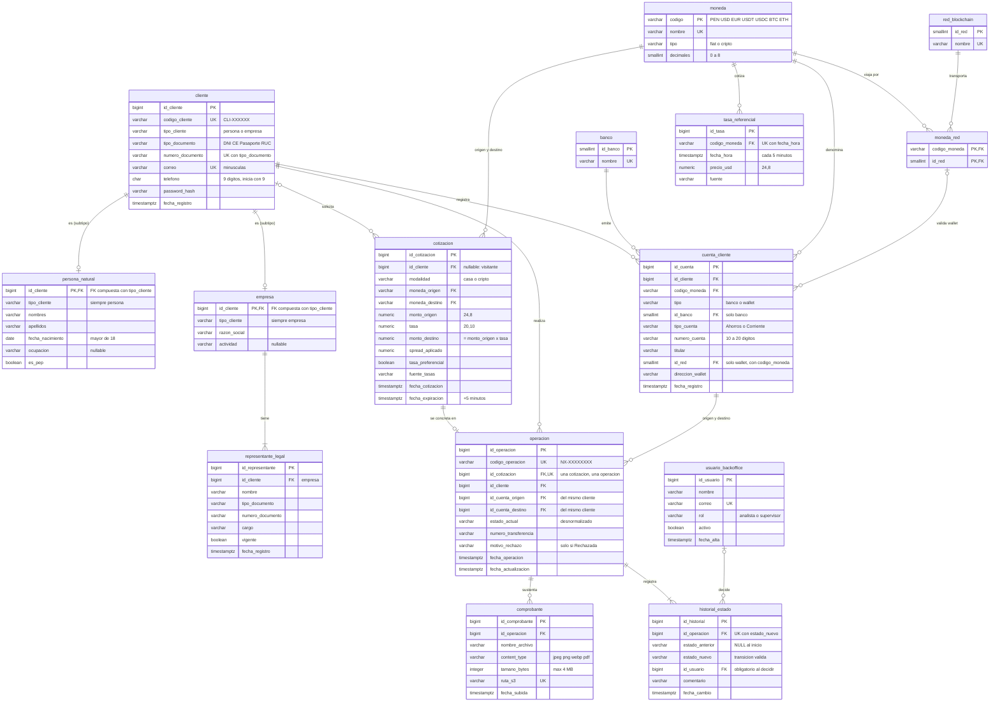

<!-- pagina: A3 landscape -->
# NexoCambio · Modelo Entidad–Relación

Grupo 1 · Curso de Base de Datos · UTEC Posgrado · 15 entidades en Tercera Forma Normal (3FN) · PostgreSQL 18 · esquema `nexocambio`

**Notación:** pata de gallo (crow's foot). `||` = exactamente uno · `|o` = cero o uno · `|{` = uno o muchos · `o{` = cero o muchos. PK = clave primaria, FK = clave foránea, UK = restricción UNIQUE.

# Cardinalidades y restricciones relevantes

| Relación | Cardinalidad | Cómo se implementa |
|---|---|---|
| cliente – persona_natural / empresa | 1 : 0..1, **excluyente** | El subtipo repite `tipo_cliente` (fijado con CHECK) y referencia `cliente(id_cliente, tipo_cliente)` con una FK compuesta: un cliente no puede ser persona y empresa a la vez. |
| empresa – representante_legal | 1 : 1..N | FK a `empresa`: una persona natural no puede tener representante. Se guarda el histórico con `vigente`. |
| cliente – cuenta_cliente | 1 : 0..N | Las cuentas se reutilizan entre operaciones. CHECK de coherencia banco/wallet. |
| **moneda – red_blockchain** | **N : M** | Resuelta con la tabla asociativa `moneda_red` (PK compuesta). La FK compuesta `(codigo_moneda, id_red)` de `cuenta_cliente` impide, por ejemplo, una wallet USDT en la red Bitcoin. |
| moneda – tasa_referencial | 1 : 0..N | UNIQUE `(codigo_moneda, fecha_hora)`: una tasa por moneda y por bloque de 5 minutos. |
| cliente – cotizacion | 0..1 : 0..N | `id_cliente` admite NULL porque `POST /cotizar` es una ruta pública (visitantes). |
| cotizacion – operacion | 1 : 0..1 | UNIQUE `operacion.id_cotizacion`: una cotización se concreta una sola vez. |
| cuenta_cliente – operacion | 1 : 0..N (dos roles) | FK compuesta `(id_cuenta_origen, id_cliente)` y `(id_cuenta_destino, id_cliente)` contra `cuenta_cliente(id_cuenta, id_cliente)`: ambas cuentas son del cliente de la operación. CHECK origen ≠ destino. |
| operacion – comprobante | 1 : 0..N | El cliente puede reemplazar el comprobante mientras está "Pendiente de validación". CHECK de formato y tamaño. |
| operacion – historial_estado | 1 : 1..N | CHECK sobre el par (estado_anterior, estado_nuevo) con la máquina de estados del negocio. UNIQUE `(id_operacion, estado_nuevo)`. |
| usuario_backoffice – historial_estado | 0..1 : 0..N | NULL cuando el cambio lo hace el sistema o el cliente; obligatorio en En proceso, Procesada y Rechazada. |

**Máquina de estados** (CHECK `ck_historial_transicion`): (inicio) → Pendiente de comprobante → Pendiente de validación → En proceso → Procesada. También se puede pasar a Rechazada desde Pendiente de validación y desde En proceso.

# Diccionario de datos

| Tabla | Columna | Tipo | Nulo | Restricciones |
|---|---|---|---|---|
| **cliente** | id_cliente | BIGINT IDENTITY | No | PK |
| | codigo_cliente | VARCHAR(10) | No | UNIQUE · CHECK `^CLI-[A-Z0-9]{6}$` |
| | tipo_cliente | VARCHAR(7) | No | CHECK persona / empresa · UNIQUE (id_cliente, tipo_cliente) |
| | tipo_documento, numero_documento | VARCHAR(9), VARCHAR(12) | No | UNIQUE (tipo, número) · CHECK de formato por tipo · empresa ⇔ RUC |
| | correo | VARCHAR(120) | No | UNIQUE · CHECK minúsculas y formato |
| | telefono | CHAR(9) | No | CHECK `^9[0-9]{8}$` |
| | password_hash, fecha_registro | VARCHAR(255), TIMESTAMPTZ | No | DEFAULT now() |
| **persona_natural** | id_cliente | BIGINT | No | PK · FK (id_cliente, tipo_cliente) → cliente |
| | nombres, apellidos | VARCHAR(100) | No | |
| | fecha_nacimiento | DATE | No | CHECK mayor de 18 años |
| | ocupacion | VARCHAR(13) | Sí | CHECK lista cerrada |
| | es_pep | BOOLEAN | No | DEFAULT false |
| **empresa** | id_cliente | BIGINT | No | PK · FK (id_cliente, tipo_cliente) → cliente |
| | razon_social / actividad | VARCHAR(150) / VARCHAR(12) | No / Sí | CHECK actividad en lista cerrada |
| **representante_legal** | id_representante | BIGINT IDENTITY | No | PK |
| | id_cliente | BIGINT | No | FK → empresa · UNIQUE (id_cliente, tipo_documento, numero_documento) |
| | nombre, tipo_documento, numero_documento, cargo, vigente | | No | CHECK tipo de documento de persona |
| **moneda** | codigo | VARCHAR(5) | No | PK · CHECK `^[A-Z]{3,5}$` |
| | nombre / tipo / decimales | VARCHAR(40) / VARCHAR(6) / SMALLINT | No | UNIQUE nombre · CHECK fiat/cripto · CHECK 0–8 |
| **banco**, **red_blockchain** | id, nombre | SMALLINT IDENTITY, VARCHAR(40) | No | PK · UNIQUE nombre |
| **moneda_red** | codigo_moneda, id_red | VARCHAR(5), SMALLINT | No | PK compuesta · FK → moneda, red_blockchain |
| **cuenta_cliente** | id_cuenta | BIGINT IDENTITY | No | PK · UNIQUE (id_cuenta, id_cliente) |
| | id_cliente / codigo_moneda / tipo | | No | FK → cliente, moneda · CHECK banco/wallet |
| | id_banco, tipo_cuenta, numero_cuenta, titular | | Sí | FK → banco · CHECK `^[0-9]{10,20}$` · obligatorios si tipo = banco |
| | id_red, direccion_wallet | | Sí | FK (codigo_moneda, id_red) → moneda_red · obligatorios si tipo = wallet |
| **tasa_referencial** | id_tasa | BIGINT IDENTITY | No | PK |
| | codigo_moneda, fecha_hora, precio_usd, fuente | VARCHAR(5), TIMESTAMPTZ, NUMERIC(24,8), VARCHAR(30) | No | FK → moneda · UNIQUE (moneda, fecha_hora) · CHECK precio > 0 |
| **cotizacion** | id_cotizacion | BIGINT IDENTITY | No | PK |
| | id_cliente | BIGINT | Sí | FK → cliente (ON DELETE SET NULL) |
| | modalidad, moneda_origen, moneda_destino | VARCHAR | No | CHECK casa/cripto · FK → moneda · CHECK origen ≠ destino |
| | monto_origen, tasa, monto_destino | NUMERIC(24,8), NUMERIC(20,10), NUMERIC(24,8) | No | CHECK > 0 · CHECK abs(destino − origen × tasa) ≤ 0,005 |
| | spread_aplicado, tasa_preferencial, fuente_tasas | NUMERIC(6,5), BOOLEAN, VARCHAR(11) | No | CHECK 0 ≤ spread < 0,1 · CHECK fuente en lista |
| | fecha_cotizacion, fecha_expiracion | TIMESTAMPTZ | No | CHECK vigencia entre 1 y 30 minutos |
| **usuario_backoffice** | id_usuario, nombre, correo, rol, activo, fecha_alta | | No | PK · UNIQUE correo · CHECK analista/supervisor |
| **operacion** | id_operacion | BIGINT IDENTITY | No | PK |
| | codigo_operacion | VARCHAR(11) | No | UNIQUE · CHECK `^NX-[A-Z0-9]{8}$` |
| | id_cotizacion | BIGINT | No | FK → cotizacion · UNIQUE |
| | id_cliente, id_cuenta_origen, id_cuenta_destino | BIGINT | No | FK → cliente · FK compuestas → cuenta_cliente · CHECK origen ≠ destino |
| | estado_actual | VARCHAR(25) | No | CHECK 5 estados · DEFAULT Pendiente de comprobante |
| | motivo_rechazo, numero_transferencia | VARCHAR(300), VARCHAR(40) | Sí | CHECK motivo ⇔ Rechazada |
| | fecha_operacion, fecha_actualizacion | TIMESTAMPTZ | No | CHECK actualización ≥ operación |
| **comprobante** | id_comprobante, id_operacion | BIGINT | No | PK · FK → operacion (CASCADE) |
| | nombre_archivo, content_type, tamano_bytes, ruta_s3, fecha_subida | | No | CHECK 4 formatos · CHECK 1 B – 4 MB · UNIQUE ruta_s3 |
| **historial_estado** | id_historial, id_operacion | BIGINT | No | PK · FK → operacion (CASCADE) · UNIQUE (id_operacion, estado_nuevo) |
| | estado_anterior, estado_nuevo | VARCHAR(25) | Sí / No | CHECK transición válida |
| | id_usuario, comentario, fecha_cambio | BIGINT, VARCHAR(300), TIMESTAMPTZ | Sí, Sí, No | FK → usuario_backoffice · CHECK responsable obligatorio al decidir |
