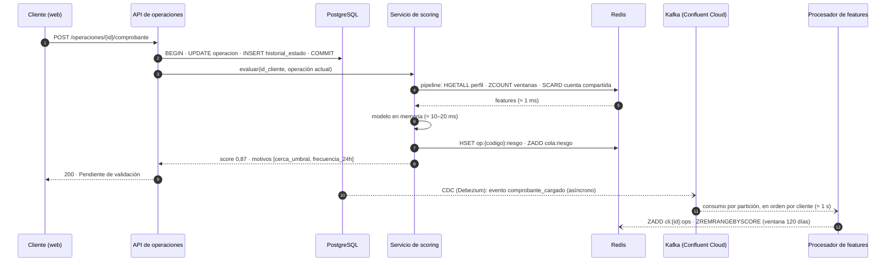
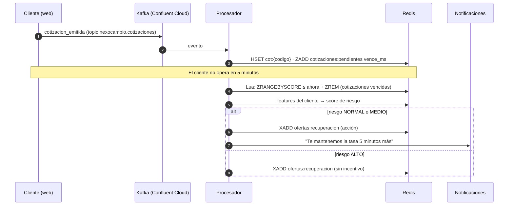

<!-- pagina: A4 landscape -->
# NexoCambio · Arquitectura de datos para la detección de operaciones inusuales

Grupo 1 · Curso de Base de Datos · Parte 2 · **PostgreSQL** (núcleo transaccional) + **Redis** (feature store en línea) + **Kafka en Confluent Cloud** (eventos) + **Databricks** sobre Delta Lake en S3 (analítica y entrenamiento)

<svg viewBox="0 20 1400 640" xmlns="http://www.w3.org/2000/svg" font-family="Segoe UI, Arial, sans-serif" font-size="13">
<defs><marker id="f" viewBox="0 0 10 10" refX="9" refY="5" markerWidth="7" markerHeight="7" orient="auto-start-reverse"><path d="M0,0 L10,5 L0,10 z" fill="#44505c"/></marker></defs>
<g fill-opacity="1" stroke="#c9d2da">
<rect x="20" y="60" width="190" height="410" rx="10" fill="#f4f6f8"/>
<rect x="235" y="60" width="240" height="410" rx="10" fill="#f4f6f8"/>
<rect x="495" y="60" width="265" height="410" rx="10" fill="#eaf1f8"/>
<rect x="775" y="60" width="240" height="410" rx="10" fill="#fdf3e7"/>
<rect x="1035" y="60" width="345" height="410" rx="10" fill="#fbecec"/>
<rect x="20" y="500" width="1360" height="150" rx="10" fill="#edf6ef"/>
</g>
<g font-weight="600" fill="#5a6675" font-size="12.5">
<text x="115" y="82" text-anchor="middle">APLICACIONES CONSUMIDORAS</text>
<text x="355" y="82" text-anchor="middle">APIs · AWS</text>
<text x="627" y="82" text-anchor="middle">DATOS TRANSACCIONALES</text>
<text x="895" y="82" text-anchor="middle">PROCESAMIENTO EN TIEMPO REAL</text>
<text x="1207" y="82" text-anchor="middle">FEATURE STORE EN LÍNEA</text>
<text x="40" y="522">ANALÍTICA Y MACHINE LEARNING (BATCH) · DATABRICKS</text>
</g>
<g stroke="#44505c" stroke-width="1.6" fill="none" marker-end="url(#f)">
<path d="M190,125 L255,122"/>
<path d="M190,235 C228,235 225,132 255,130"/>
<path d="M355,145 L355,175"/>
<path d="M455,195 L520,160"/>
<path d="M455,228 L565,275"/>
<path d="M355,245 L355,335"/>
<path d="M455,358 L1080,322"/>
<path d="M1080,352 L455,388"/>
<path d="M670,118 L790,112"/>
<path d="M895,132 L895,160"/>
<path d="M895,210 L895,240"/>
<path d="M1000,265 L1080,280"/>
<path d="M1000,185 L1025,185 L1025,587 L962,587"/>
<path d="M790,587 L742,587"/>
<path d="M545,205 L545,538"/>
<path d="M560,587 L502,587"/>
<path d="M330,587 L292,587"/>
<path d="M200,555 L300,407"/>
<path d="M600,95 L600,42 L1220,42 L1220,228" stroke-dasharray="6 4"/>
</g>
<g font-size="12" fill="#1d2733">
<text x="468" y="224">1 · SQL ACID</text>
<text x="362" y="296">2 · ¿riesgo?</text>
<text x="362" y="311" fill="#5a6675">(síncrono)</text>
<text x="770" y="326" text-anchor="middle">3 · lee features en pipeline (&lt; 5 ms)</text>
<text x="770" y="392" text-anchor="middle">4 · score, motivos y cola priorizada por riesgo</text>
<text x="700" y="106">5 · WAL</text>
<text x="902" y="230">6 · eventos</text>
<text x="1000" y="258" font-size="10">ZADD · HINCRBY</text>
<text x="1030" y="455">7 · histórico</text>
<text x="552" y="440">8 · export nocturno</text>
<text x="552" y="455" fill="#5a6675">v_features_cliente</text>
<text x="160" y="480">9 · despliegue</text>
<text x="905" y="37" text-anchor="middle" fill="#5a6675">perfil batch nocturno → HSET cli:{id}:perfil</text>
</g>
<g stroke="#44505c" stroke-width="1.3">
<rect x="40" y="100" width="150" height="50" rx="6" fill="#fff"/>
<rect x="40" y="210" width="150" height="50" rx="6" fill="#fff"/>
<rect x="255" y="100" width="200" height="45" rx="6" fill="#fff"/>
<rect x="255" y="175" width="200" height="70" rx="6" fill="#fff"/>
<rect x="255" y="335" width="200" height="70" rx="6" fill="#fff" stroke="#b03a3a" stroke-width="2"/>
<rect x="790" y="92" width="210" height="40" rx="6" fill="#fff"/>
<rect x="790" y="160" width="210" height="50" rx="6" fill="#fff" stroke="#c46a12" stroke-width="2"/>
<rect x="790" y="240" width="210" height="50" rx="6" fill="#fff"/>
<rect x="790" y="560" width="170" height="55" rx="6" fill="#fff"/>
<rect x="330" y="560" width="170" height="55" rx="6" fill="#fff"/>
<rect x="60" y="555" width="230" height="65" rx="6" fill="#fff" stroke="#2e7d4f" stroke-width="2"/>
</g>
<g stroke-width="2">
<path d="M520,105 v90 a75,10 0 0 0 150,0 v-90" fill="#fff" stroke="#0f5b78"/><ellipse cx="595" cy="105" rx="75" ry="10" fill="#dcebf4" stroke="#0f5b78"/>
<path d="M565,250 v55 a85,10 0 0 0 170,0 v-55" fill="#fff" stroke="#44505c" stroke-width="1.3"/><ellipse cx="650" cy="250" rx="85" ry="10" fill="#f1f3f5" stroke="#44505c" stroke-width="1.3"/>
<path d="M1080,240 v130 a140,12 0 0 0 280,0 v-130" fill="#fff" stroke="#b03a3a"/><ellipse cx="1220" cy="240" rx="140" ry="12" fill="#f6dede" stroke="#b03a3a"/>
<path d="M560,550 v75 a90,10 0 0 0 180,0 v-75" fill="#fff" stroke="#2e7d4f"/><ellipse cx="650" cy="550" rx="90" ry="10" fill="#dff0e4" stroke="#2e7d4f"/>
</g>
<g text-anchor="middle" fill="#1d2733">
<text x="115" y="122" font-weight="600">App web Angular</text><text x="115" y="138" font-size="11.5" fill="#5a6675">clientes</text>
<text x="115" y="232" font-weight="600">Back-office</text><text x="115" y="248" font-size="11.5" fill="#5a6675">analistas y supervisores</text>
<text x="355" y="128" font-weight="600">API Gateway</text>
<text x="355" y="203" font-weight="600">Servicios de negocio</text><text x="355" y="220" font-size="11.5" fill="#5a6675">cotizaciones · clientes</text><text x="355" y="234" font-size="11.5" fill="#5a6675">operaciones · back-office</text>
<text x="355" y="363" font-weight="600">Servicio de scoring</text><text x="355" y="380" font-size="11.5" fill="#5a6675">inferencia en línea</text><text x="355" y="394" font-size="11.5" fill="#5a6675">modelo en memoria</text>
<text x="595" y="140" font-weight="700" font-size="14">PostgreSQL</text><text x="595" y="158" font-size="11.5" fill="#5a6675">núcleo relacional · 15 tablas</text><text x="595" y="173" font-size="11.5" fill="#5a6675">ACID · sistema de registro</text>
<text x="650" y="282" font-weight="600">Amazon S3</text><text x="650" y="298" font-size="11.5" fill="#5a6675">comprobantes</text>
<text x="895" y="117" font-weight="600" font-size="12.5">CDC · conector Debezium</text>
<text x="895" y="181" font-weight="700">Apache Kafka</text><text x="895" y="198" font-size="11.5" fill="#5a6675">Confluent Cloud · clave id_cliente</text>
<text x="895" y="261" font-weight="600">Procesador de features</text><text x="895" y="278" font-size="11.5" fill="#5a6675">consumer group · incremental</text>
<text x="1220" y="282" font-weight="700" font-size="15">Redis (ElastiCache)</text><text x="1220" y="302" font-size="12" fill="#5a6675">feature store en línea</text><text x="1220" y="320" font-size="11.5" fill="#5a6675">perfil · ventanas deslizantes</text><text x="1220" y="336" font-size="11.5" fill="#5a6675">riesgo por operación · cola</text><text x="1220" y="352" font-size="11.5" fill="#5a6675">TTL · datos derivados</text>
<text x="875" y="584" font-weight="600">Structured Streaming</text><text x="875" y="600" font-size="11.5" fill="#5a6675">Kafka → Delta (bronze)</text>
<text x="650" y="585" font-weight="700">Delta Lake en S3</text><text x="650" y="602" font-size="11.5" fill="#5a6675">bronze · silver · gold</text>
<text x="415" y="584" font-weight="600">Spark SQL · notebooks</text><text x="415" y="600" font-size="11.5" fill="#5a6675">features históricas</text>
<text x="175" y="580" font-weight="700">MLflow</text><text x="175" y="597" font-size="11.5" fill="#5a6675">entrenamiento · validación</text><text x="175" y="611" font-size="11.5" fill="#5a6675">registro de modelos</text>
</g>
</svg>

| # | Flujo | Tecnología | Por qué ahí |
|---|---|---|---|
| 1 | Los servicios registran clientes, cotizaciones, operaciones y decisiones | **PostgreSQL** | Integridad referencial, máquina de estados con CHECK, transacciones ACID: es el *sistema de registro*. |
| 2–4 | Al cargar el comprobante, la API pide un puntaje de riesgo; el servicio de scoring lee las features del cliente y guarda el resultado | **Redis** | Lectura por clave en menos de 1 ms, ventanas deslizantes con sorted sets, TTL nativo. Evita agregar el historial en PostgreSQL en cada evento. |
| 5–6 | Cada cambio confirmado en PostgreSQL se publica como evento (Change Data Capture con el conector Debezium) | **Kafka (Confluent Cloud)** | Desacopla: la API no escribe en dos bases. La clave del mensaje es `id_cliente`, así que los eventos de un cliente caen en la misma partición y el procesador los aplica en orden. |
| 7–8 | Databricks lee los topics de Kafka (Structured Streaming) y recibe una foto diaria de `v_features_cliente`; todo queda en tablas Delta (bronze → silver → gold) | **Databricks + Delta Lake en S3** | Almacenamiento columnar barato para entrenar con todo el histórico sin cargar la base transaccional. Delta agrega transacciones ACID y versiones sobre los archivos del Data Lake. **Implementado:** el notebook `ingesta_kafka_bronze` lee los topics con Structured Streaming (`availableNow` + checkpoint) y `pipeline_medallion` construye silver y gold (features, riesgo, exposición y reactivación); el histórico entra por lotes desde extractos de PostgreSQL. Ambos corren encadenados en el Job `nexocambio_pipeline`. |
| 9 | Se entrena, valida, registra y despliega el modelo (Isolation Forest / gradient boosting) | **MLflow (Databricks)** | Cada entrenamiento queda versionado con sus parámetros y métricas; el servicio de scoring carga la versión aprobada. Las etiquetas salen de las decisiones del back-office (rechazos por cumplimiento). |

# Flujo de scoring en tiempo real y presupuesto de latencia

| Tramo | Presupuesto | Justificación |
|---|---|---|
| Transacción en PostgreSQL | ≤ 20 ms | UPDATE por PK + INSERT; ya medido en la Parte 1 (los índices de O1 y O2 mantienen las lecturas en menos de 1 ms). |
| Lectura de features en Redis | ≤ 5 ms (p99) | 6–8 comandos en un solo *pipeline*: un viaje de red. |
| Inferencia | ≤ 30 ms | Modelo de árboles cargado en memoria en el servicio. |
| **Total agregado a la API** | **≤ 60 ms** | El cliente no percibe la diferencia; el analista recibe la operación ya clasificada. |
| Frescura de las ventanas (CDC → Redis) | ≤ 5 s | La operación actual se suma en el propio servicio de scoring; el evento asíncrono actualiza el estado para la siguiente. |

# Segundo uso: recuperación de cotizaciones abandonadas

La misma arquitectura atiende un objetivo comercial. La tasa garantizada dura 5 minutos: si vence sin que el cliente opere, el procesador consulta su riesgo y decide una acción para recuperarlo, salvo que sea de riesgo ALTO.

| Tramo | Tecnología | Por qué ahí |
|---|---|---|
| Emitir y transportar la cotización | **Kafka** (topic `nexocambio.cotizaciones`, clave `id_cliente`) | El mismo bus de eventos; la cotización y la operación de un cliente llegan en orden |
| Saber qué cotizaciones vencieron | **Redis** (*sorted set* por vencimiento + script Lua) | Consulta por rango de tiempo en O(log n); atómica aunque haya varios procesadores |
| Decidir si se ofrece un incentivo | **Redis** (features) + modelo de riesgo | El mismo score de cumplimiento actúa como filtro: no se premia al cliente riesgoso |
| Registrar las ofertas | **Redis Stream** `ofertas:recuperacion` | El área comercial y el servicio de notificaciones las leen en orden |

**Qué NO cambia:** PostgreSQL sigue siendo la única fuente de verdad. Redis guarda datos **derivados y reconstruibles**: si se pierde, se repuebla desde PostgreSQL (perfil batch) y desde Kafka (retención de 7 días: se vuelve a leer desde un *offset* anterior) o desde el Data Lake. El back-office ve la cola ordenada por riesgo, pero la decisión se registra siempre en `historial_estado`.
